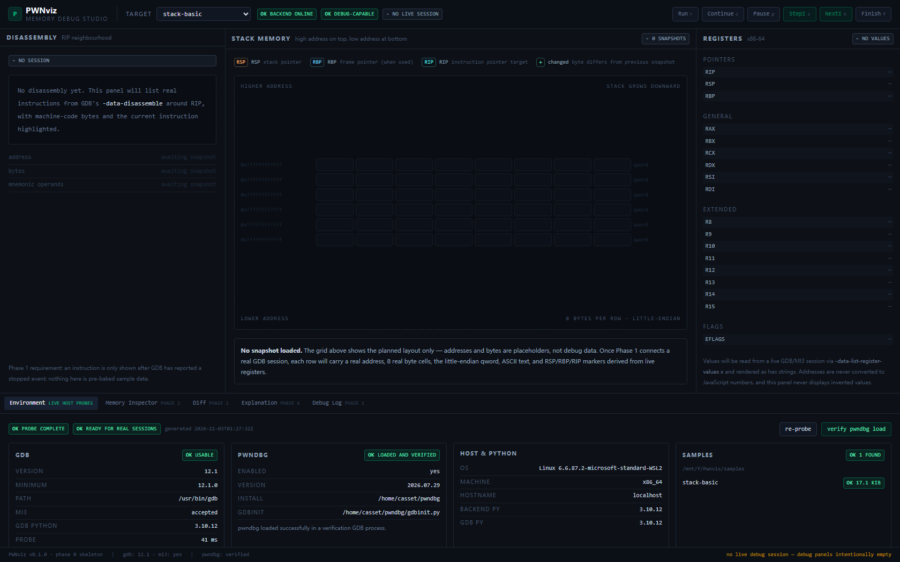

# PWNviz

**面向 CTF PWN 初学者的真实进程内存可视化调试教学平台。**

PWNviz 不是 CPU 模拟器，也不是 pwndbg 终端输出的 HTML 包装器。它启动真实 Linux
ELF 进程，用真实 GDB（MI3）执行指令，采集真实寄存器/栈帧/内存/反汇编，再把结果
渲染成可视化工作台。

> **真实性原则**：UI 占位可以存在，但任何寄存器值、地址、字节、指令都必须来自
> 真实 GDB 会话。Phase 0 的调试面板明确标注 “no live session”，不展示任何伪造数据。

---

## 当前状态：Phase 0（环境探测与骨架）

已完成：

- monorepo 骨架：`frontend/`、`backend/`、`samples/`、`scripts/`、`docs/`；
- FastAPI 后端：`/health`、`/api/v1/capabilities`、`/api/v1/samples`；
- 真实环境探测：`gdb --version`、GDB 内嵌 Python、`--interpreter=mi3` 支持、
  架构判定（x86-64 门控）、pwndbg 安装检测 + 按需真实加载验证；
- 公开配置 `GDB_PATH` / `PWNDBG_INIT` / `API_HOST` / `API_PORT` /
  `ALLOWED_SAMPLE_DIR`，GDB 缺失时后端仍可启动并返回 `unavailable`；
- 内置样例 `samples/stack-basic/demo.c` 与编译脚本；
- React + TypeScript + Vite + Tailwind + Zustand 深色 IDE 工作台骨架，
  环境面板展示真实探测结果；
- 本机安全护栏：非 loopback 绑定默认拒绝、`Host` 白名单、
  跨站浏览器请求拒绝、CORS 收紧、子进程组超时清理；
- 单元测试与真实环境集成测试（pytest，75 passed），其中包含真实
  GDB/MI3 load → break main → run → stepi → 读内存 → 清理的冒烟测试；
- 环境检查脚本在本机 0 failure / 0 warning。



> 截图由 headless Edge 打开 `http://127.0.0.1:5173` 生成；面板中的 GDB 12.1、
> MI3、pwndbg 2026.07.29、样例 17.1 KiB 均来自后端真实探测。

尚未实现（Phase 1 起）：

- 持久 GDB/MI3 子进程、命令队列、`*stopped` 事件处理；
- Step Instruction / Continue / Pause / Finish 的真实动作；
- 真实 snapshot 采集（寄存器、栈帧、RSP 附近内存、RIP 反汇编）；
- WebSocket 推送、栈内存图形视图、字节级 diff。

阶段计划与验收标准见 [docs/PHASES.md](docs/PHASES.md)。

---

## 快速开始（Windows + WSL2）

本项目调试器必须运行在 Linux 上，因此后端在 WSL2/Ubuntu 中运行，前端开发服务器
在 Windows 上运行，Vite 通过代理访问 WSL 中的后端。

### 0. 前置条件

| 组件 | 版本要求 | 本机实测 |
|---|---|---|
| WSL2 Ubuntu | 22.04 / 24.04 | Ubuntu 22.04.5 LTS |
| GDB | 12.1+ | 12.1（Ubuntu 12.1-0ubuntu1~22.04.2） |
| GCC | 任意现代版本 | 11.4.0 |
| Python | 3.10+ | 3.10.12 |
| Node.js（Windows） | 20+ | v24.19.0 |
| pwndbg | 可选 | `/home/casset/pwndbg`，已验证可加载 |

### 1. 安装后端依赖（WSL）

```bash
wsl -d Ubuntu-22.04 -- bash /mnt/f/Pwnvis/scripts/wsl_bootstrap.sh
```

### 2. 检查真实环境（WSL）

```bash
wsl -d Ubuntu-22.04 -- bash /mnt/f/Pwnvis/scripts/check_environment.sh
```

该脚本只做真实检测，不安装任何东西；缺失 GDB 时会给出可操作的错误。
`[PASS]/[WARN]/[FAIL]` 均来自实际执行的命令。

### 3. 编译教学样例（WSL）

```bash
wsl -d Ubuntu-22.04 -- bash /mnt/f/Pwnvis/scripts/build_samples.sh
```

### 4. 启动后端（WSL，前台运行）

```bash
wsl -d Ubuntu-22.04 -- bash /mnt/f/Pwnvis/scripts/dev_backend.sh
```

也可以直接：

```bash
cd backend
~/.venvs/pwnviz/bin/python -m app
```

`python -m app` 会读取 `.env` 中的 `API_HOST` / `API_PORT`
（默认 `127.0.0.1:8000`）。启动后访问 `/docs` 查看 OpenAPI。

### 5. 启动前端（Windows PowerShell）

```powershell
cd F:\Pwnvis\frontend
npm install
npm run dev
```

打开 <http://127.0.0.1:5173>。页面底部的 **Environment** 标签展示后端真实探测结果；
GDB / MI3 / pwndbg / 样例状态一目了然。

### 6. 运行测试

```bash
wsl -d Ubuntu-22.04 -- bash -lc 'cd /mnt/f/Pwnvis/backend && ~/.venvs/pwnviz/bin/python -m pytest -v'
```

虚拟环境默认安装在 WSL ext4 的 `~/.venvs/pwnviz`（避免 `/mnt/f` 上的 NTFS
I/O 拖慢 pip），可用 `PWNVIZ_VENV` 覆盖。

集成测试会真实启动 `gdb --version`、`gdb --batch --interpreter=mi3`，并在
pwndbg 可用时真实加载它；`tests/integration/test_gdb_mi_smoke.py` 还会真实加载
样例、命中 `main`、单步一条指令、读取寄存器/内存并确认 inferior 进程退出。
不会用 mock 冒充调试成功。

### 7. 配置（`.env`）

复制 `.env.example` 为 `.env`（该文件被 git 忽略）。Phase 0 的公开配置项：

| 变量 | 默认值 | 说明 |
|---|---|---|
| `GDB_PATH` | `gdb` | GDB 可执行文件名或绝对路径；不存在时后端照常启动 |
| `PWNDBG_INIT` | 空 | `gdbinit.py` 文件或其所在目录；空则自动检测 |
| `API_HOST` | `127.0.0.1` | 后端绑定地址；非 loopback 默认拒绝启动 |
| `API_PORT` | `8000` | 后端绑定端口（非法值回退 8000） |
| `ALLOWED_SAMPLE_DIR` | `<repo>/samples` | 只允许发现该目录之下的样例 |
| `PWNVIZ_ALLOW_REMOTE` | `0` | 显式允许非 loopback 绑定（不推荐） |
| `PWNVIZ_ALLOWED_HOSTS` | `127.0.0.1,localhost,testserver` | `Host` 头白名单 |

可选调优项（`PWNVIZ_*`：pwndbg 开关、超时、缓存 TTL、CORS、栈窗口）见
[.env.example](.env.example)。旧的 `PWNVIZ_GDB_BINARY` / `PWNVIZ_PWNDBG_PATH` /
`PWNVIZ_SAMPLES_DIR` / `PWNVIZ_HOST` / `PWNVIZ_PORT` 仍作为兼容别名。

安全模型与审计结论见 [docs/SECURITY.md](docs/SECURITY.md) 与
[docs/DEVELOPMENT.md](docs/DEVELOPMENT.md#14-安全--架构-review-记录2026-11-03)。

---

## 目录结构

```text
Pwnvis/
├── frontend/                 # React + TS + Vite + Tailwind + Zustand
│   └── src/
│       ├── app/              # Workbench 布局
│       ├── components/       # Toolbar / StackMemoryView / RegisterPanel / ...
│       ├── hooks/            # useCapabilities / useSamples
│       ├── services/         # 类型化 API 客户端
│       ├── stores/           # Zustand session/UI 状态
│       └── types/            # 与后端 schema 对齐的 TS 类型
├── backend/                  # FastAPI
│   ├── app/
│   │   ├── api/              # health / capabilities / samples 路由
│   │   ├── core/             # config / errors / logging / proc
│   │   ├── debugger/         # 环境探测（Phase 1 增加 MI controller）
│   │   ├── samples/          # 样例发现
│   │   └── schemas/          # Pydantic v2 模型
│   └── tests/                # unit + integration
├── samples/                  # 教学 C 样例与 README
├── scripts/                  # bootstrap / 环境检查 / 编译 / 启动
├── docs/                     # ARCHITECTURE / API / DEVELOPMENT / PHASES / SECURITY
├── .env.example
└── README.md
```

---

## 架构要点（Phase 0 已确立）

1. 前端只做交互与渲染，绝不直接执行 GDB；
2. 每个调试会话将拥有一个**长期运行**的 GDB/MI3 子进程（Phase 1），
   不会每次单步重启 GDB；
3. 同一会话的所有动作串行化，MI 命令完成记录与 `*running`/`*stopped`
   异步事件分开处理；
4. 地址与 64-bit 值在 JSON 中使用十六进制字符串，前端绝不转成 JS Number；
5. 原始字节是事实；变量名、类型、返回地址只是语义标注，必须有 DWARF/GDB 证据；
6. RBP 仅是寄存器，调用栈以 GDB frame unwinder 为依据；
7. pwndbg 是可选增强层，加载失败自动退化为原生 GDB；
8. MVP 仅面向本机可信教学 ELF，不开放公网任意文件执行。

详见 [docs/ARCHITECTURE.md](docs/ARCHITECTURE.md)。

---

## MVP 限制（当前明确不做）

- 不做 CPU/指令模拟器；
- 不解析 pwndbg 彩色终端文本作为数据源；
- 不承诺识别无符号 ELF 的局部变量；
- 不实现堆分配器分析、ROP 自动分析、Exploit 生成；
- 不做多用户/账号/排行；
- 未做隔离前不允许公网 ELF 上传执行。

安全边界见 [docs/SECURITY.md](docs/SECURITY.md)。

---

## API（Phase 0）

| Method | Endpoint | 说明 |
|---|---|---|
| GET | `/health` | 后端存活与配置摘要 |
| GET | `/api/v1/capabilities` | 真实探测 GDB / MI3 / Python / pwndbg / 样例 |
| GET | `/api/v1/capabilities?verify_pwndbg=true` | 额外真实加载 pwndbg 验证 |
| GET | `/api/v1/samples` | 教学样例列表与编译状态 |
| GET | `/api/v1/samples/{id}` | 单个样例 |

示例响应与字段说明见 [docs/API.md](docs/API.md)。

---

## 开发记录与实测环境

见 [docs/DEVELOPMENT.md](docs/DEVELOPMENT.md)，其中记录了本机真实执行过的命令与输出
（包括 GDB、pwndbg 加载结果、pytest 结果），以及 Windows/WSL 分工的注意事项。
