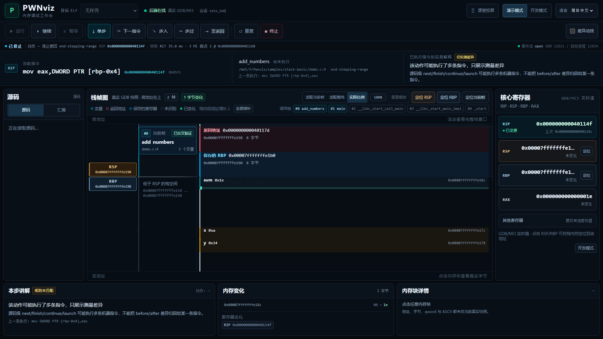
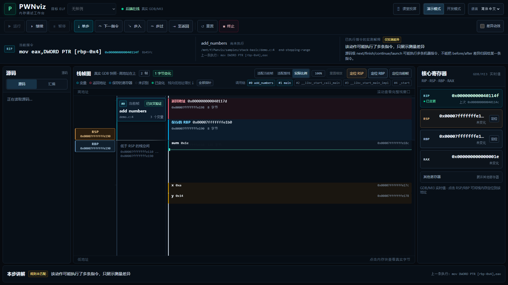
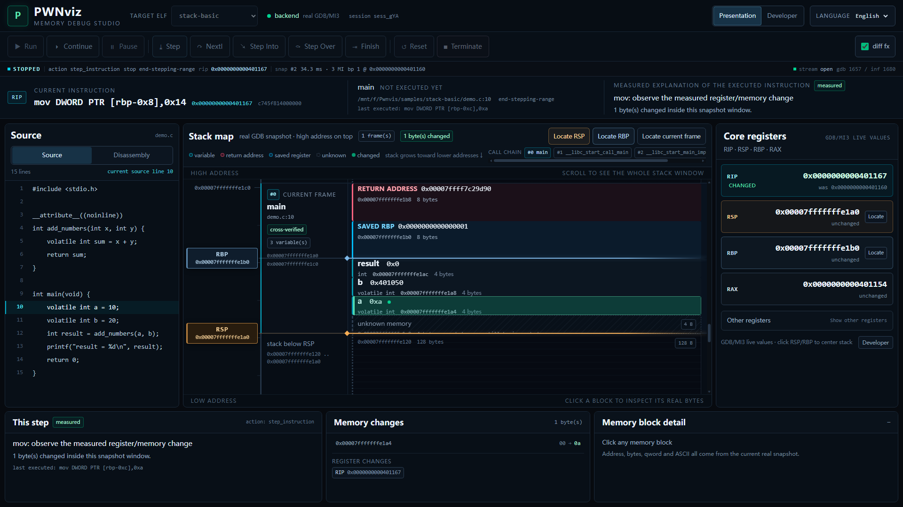
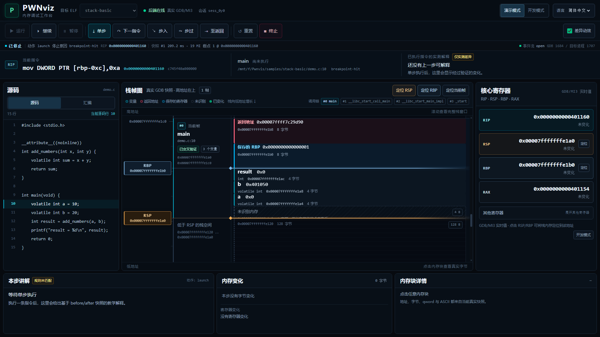
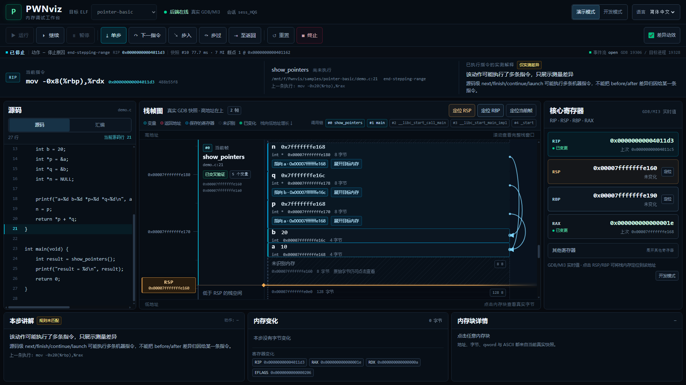
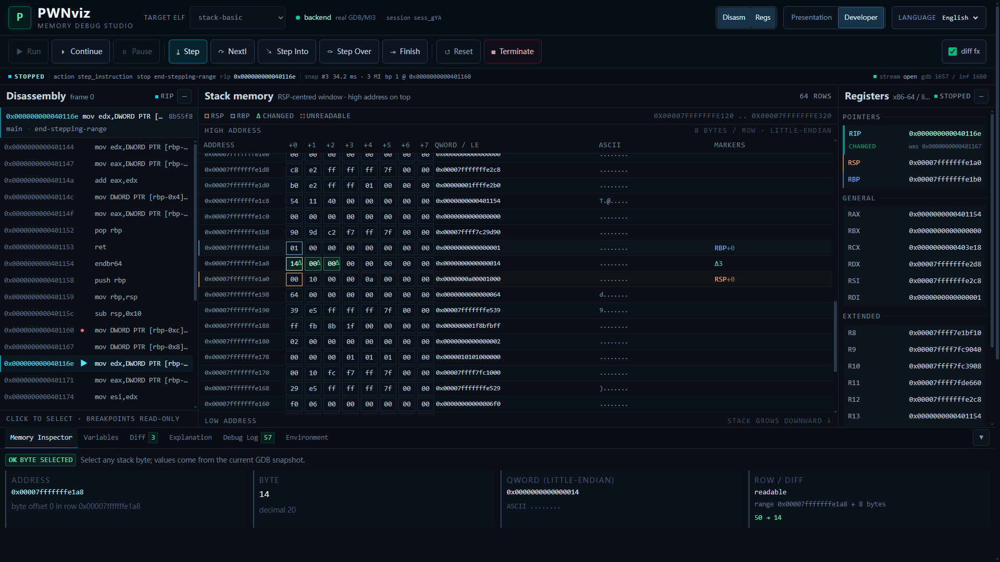
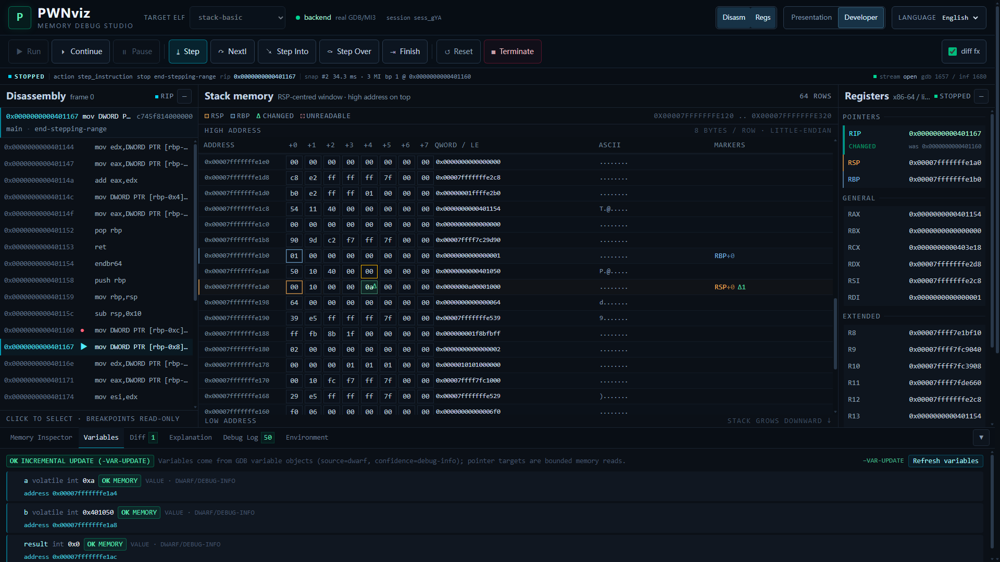
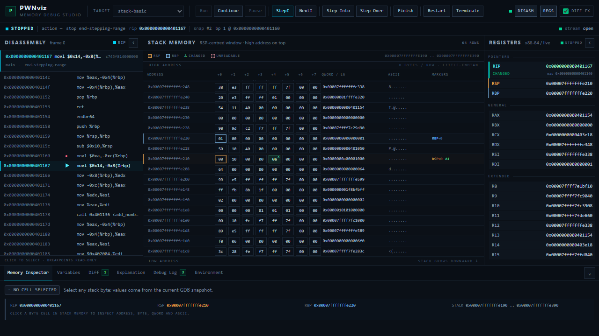
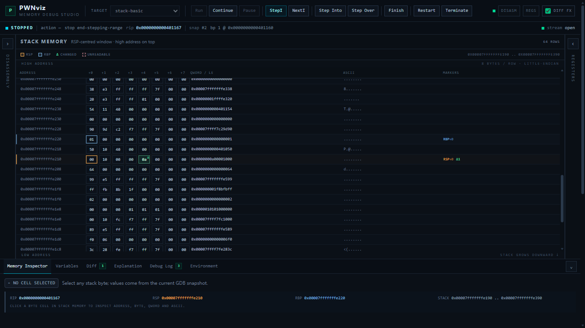

# PWNviz

**面向 CTF PWN 初学者的真实进程内存可视化调试教学平台。**

PWNviz 不是 CPU 模拟器，也不是 pwndbg 终端输出的 HTML 包装器。它启动真实 Linux
ELF 进程，用真实 GDB（MI3）执行指令，采集真实寄存器/栈帧/内存/反汇编，再把结果
渲染成可视化工作台。

> **真实性原则**：UI 占位可以存在，但任何寄存器值、地址、字节、指令都必须来自
> 真实 GDB 会话。Phase 0 的调试面板明确标注 “no live session”，不展示任何伪造数据。

> 面向 GPT/后续维护者的完整阶段进度与下一步决策材料：
> [docs/PROGRESS_FOR_GPT.md](docs/PROGRESS_FOR_GPT.md)

---

## 当前状态：Phase 3 实时工作台 + Phase 4 变量语义 + V1.1 性能与中英双语 + V1.2 图形化栈帧 + V1.3 视觉打磨 + V1.3.1 清晰度修复

### V1.3.1 亮点：StackMap 清晰度与指针路由修复（2026-11-06）

- **指针正交路由**：修复通道重叠 bug——先过滤 NULL/窗外/不可读链接，
  再按 Y 序分配连续正交通道（宽度随可见数动态计算，每条箭头独占 X，
  不共用控制点）；同块出口/同目标入口错开；hover 突出当前线、其余淡化；
- **选择聚焦**：Presentation 默认只绘制与选中内存块相关的指针关系，
  HeaderBar "全部指针" 开关显示全部真实关系（持久化）；
- **自适应标尺**：presentation 主刻度 ≥56px 间距且无次刻度（developer 更密），
  随缩放调整，地址对齐不变——不再有每 8 字节一条的细线墙；
- **纯色色带**：删除全部 repeating-linear-gradient 背景纹理；
- **RSP/RBP**：默认芯片 + 短箭头（点击临时显示全辅助线 5 秒），developer
  保留全横线；叶函数 RSP==RBP 时芯片自动错开；
- **逐字节变化标记**：按真实 diff 地址定位，不再整块绿色覆盖；变量显示
  changed count，Inspector 列出选中块 before/after；
- 新样例：`stack-deep`（多级调用）、`stack-pointers`（10 指针覆盖全部
  路由场景）、`stack-manyvars`（12 个混合局部变量）；
- Playwright 双套件 **14/14**（教学 7 + 清晰度 7，真实 GDB，禁 mock），
  截图 `docs/assets/stackmap-v1.3.1/`。

### V1.3 亮点：StackMap 视觉打磨与归属可靠性（2026-11-06）

- **缩放系统（不改变任何真实地址/字节大小）**：
  - `实际比例`：固定教学比例 10px/真实字节（100%）；
  - `适配当前帧`：以当前帧真实字节范围为基准计算缩放，使当前帧充满可视区；
  - `适配整栈`：按可视区域计算缩放，整个栈窗口一屏显示；
  - 标尺、内存块、PointerArrow、RSP/RBP Marker 全部共用同一个
    `model.pxPerByte`（`addressTop()` 唯一坐标函数），缩放不产生地址映射偏移；
  - 头部显示缩放百分比（相对 10px/byte）并提供一键重置；
  - 选择持久化在 `localStorage["pwnviz.stackZoom"]`。
- **小变量块不再裁切**：
  - 内存块高度永远严格等于真实地址空间；小于 26px 的“微型块”内部不放文字，
    变量名以**外部标注芯片**显示在帧标签列（带引线指向真实字节位置）；
  - 悬停任何块都会弹出完整信息卡（名称/类型/真实值/地址范围/字节大小/归属证据）；
  - 点击块即打开底部 Inspector（内存块详情）；
  - char / short / int / long / 指针全尺寸验证（Playwright 断言块内无裁切）。
- **变量归属三态验证（frame_level × 地址证据）**：
  - `verified`：GDB `frame_level` 与真实地址范围一致（含叶函数红区：
    局部变量在 RSP 之下 128 字节以内、且在帧基址之下时仍视为一致）；
  - `conflict`：声明的帧可见但地址证据矛盾（在其它帧范围内/超出合理区域）——
    变量按真实地址绘制并显示 ⚠，绝不强行归属；
  - `unresolved`：证据不足（声明的帧不在窗口内等），显示 ? 徽章；
  - 永远不根据变量名称猜测归属；窗口内但不在已证帧内的变量不再被静默丢弃，
    而是按真实地址独立绘制并标注。
- **栈帧标题板**：帧名使用固定高度（88px）独立标题板，位于帧标签列、
  不占用真实内存地址空间；小栈帧也能完整展示（当前帧=cyan 高亮、
  已验证调用者=次级蓝、无法验证=amber warning），不伪造帧边界。
- **演示布局优化（1920×1080）**：栈图约占 2/3 宽度、源码面板收窄、
  底部教学区压至 14vh；演示面全部字体 ≥12px（无 8–10px 大面积小字号）。
- **课堂投屏模式**：HeaderBar 一键开关（持久化 `localStorage["pwnviz.projection"]`），
  隐藏状态栏开发信息、会话 ID、次要面板；底部教学区收成单行标题条；
  核心寄存器仍只显示 RIP/RSP/RBP/RAX（其余折叠）。
- **视觉回归测试（Playwright + 真实 GDB，禁止 mock）**：
  `frontend/e2e/presentation.visual.spec.ts` 驱动真实后端逐步到 7 个检查点
  （main 调用 / push rbp 之后 / 局部变量初始化 / 返回之前 / 无 DWARF /
  无帧指针 / 投屏模式），1920×1080 zh-CN 截图到 `docs/assets/presentation/`；
  断言：标题无裁切、块内无裁切、RSP/RBP Marker 地址与快照一致、
  PointerArrow 与块同一坐标空间、栈帧无重叠、页面无横向溢出、字体 ≥11px。
  新增样例：`samples/stack-nodwarf`（-g0）、`samples/stack-nofp`
  （-fomit-frame-pointer）。运行：`scripts/run_visual_tests.sh`。





### V1.2 亮点：从缩小的 IDE 到图形化内存教学工作台（2026-11-05）

- **双模式共用同一真实数据源**：
  - Presentation（默认）：源码/汇编 + **占主要视觉面积的 StackMapCanvas** +
    核心寄存器 + 单步讲解；
  - Developer：保留 DisassemblyView / StackMemoryView / RegisterPanel /
    BottomDock / ASCII / QWORD / Byte Cell / MemoryInspector / DebugLog；
  - 模式保存在 `localStorage["pwnviz.mode"]`，两种模式都只读 `useDebugStore`。
- **真实图形化栈帧**：栈帧按高地址→低地址排列；帧边界由
  **真实 RBP 链 + GDB unwinder 的调用者 PC + 真实内存 qword 交叉验证**，
  不把 `RBP-RSP` 差值当作变量布局；函数入口、无帧指针、无 DWARF 都有明确降级。
- **真实变量内存块**：后端新增 `variables[].size_bytes`（GDB `sizeof` 实测），
  前端按真实字节数绘制；地址/间隙全部来自真实快照。
- **真实指针关系**：只有 `p` 的值与 `&a` 的 DWARF 地址完全相等才画线；
  NULL、未解析、栈窗口外、目标不可读分别显示；悬停高亮指针和目标，点击展开目标字节。
- **单步变化动画**：直接使用 `diff.changed_bytes`；460ms 绿色高亮，支持
  `prefers-reduced-motion` 和动画开关；动画不延迟真实状态更新。
- **中文教学解释**：`push rbp` / `mov rbp,rsp` / `sub rsp,N` 等在 before/after
  实测一致后追加简短中文说明（例如“预留 N 字节栈空间”），不预测未执行指令。
- **投屏基线**：1920×1080 下验证；栈帧图约 60% 宽度、正文 13–18px、
  关键按钮 46px；新增真实样例 `samples/pointer-basic` 用于指针连线。
- 完整 UI 说明与截图：[docs/UI_V12.md](docs/UI_V12.md)。









### V1.1 亮点（真实 GDB、真实 100 步实测）

| 指标 | V1.0 | V1.1 | 变化 |
|---|---|---|---|
| 单步耗时 p50 | 2630.51 ms | **45.84 ms** | 57.4× |
| 单步 GDB/MI 命令数 p50 | 26 | **4** | 6.5× |
| 栈内存读取命令/步 | 9.00 | 1.12 | 8× |
| 变量命令/步 | 12.52 | 2.08 | 6× |
| launch 快照 | 3535.9 ms | 350.9 ms | 10.1× |
| 前端 commits/快照 | 2.22 | 1.04 | 2.1× |
| StackMemoryView 渲染 p50 | 5.3 ms | **0.3 ms** | 17.7× |

- **Fast / Full 两级快照**：单步默认 Fast（寄存器、栈内存、diff、当前指令、
  增量变量），launch 与显式刷新为 Full；两种模式都只读真实 GDB 数据；
- **一次批量读取栈窗口**：512 字节默认一条 `-data-read-memory-bytes`，失败或跨页时
  自动降级分块，不可读字节仍显示为 `--`，绝不写成 0；
- **变量对象缓存 + `-var-update`**：不再每步 `-var-create`/`-var-delete`，
  帧变化才重建；每个节点保留 `source` / `confidence`；
- **反汇编窗口缓存**：RIP 未离开窗口时 0 条命令，窗口带抓取快照版本；
- **帧刷新证据驱动**：只在 `call`/`ret`/`finish`/`continue` 等情况下 unwind，
  不用 RBP 判断帧变化；缓存时 UI 明确标注；
- **PerfStats**：每张快照携带阶段耗时、MI 命令数与 payload 字节，
  `GET /api/v1/sessions/{id}/performance` 提供 p50/p95；
- **完整中英双语**：默认简体中文，Toolbar 右上角可切 English，
  无需刷新，`localStorage["pwnviz.locale"]` 持久化；寄存器/指令/变量/地址/
  字节/GDB 原文保持原样；
- **前端渲染**：`React.memo` 化的 ByteCell/StackRowView + 每快照一次行模型构建 +
  memo 面板 + 分片 selector；>200 行才启用固定行高虚拟滚动；
- 详细数据、方法与已知成本：[docs/PERFORMANCE.md](docs/PERFORMANCE.md)；
  语言覆盖与错误码：[docs/I18N.md](docs/I18N.md)。

已完成：

- monorepo 骨架：`frontend/`、`backend/`、`samples/`、`scripts/`、`docs/`；
- FastAPI 后端：`/health`、`/api/v1/capabilities`、`/api/v1/samples`；
- 真实环境探测：`gdb --version`、GDB 内嵌 Python、`--interpreter=mi3` 支持、
  架构判定（x86-64 门控）、pwndbg 安装检测 + 按需真实加载验证；
- 公开配置 `GDB_PATH` / `PWNDBG_INIT` / `API_HOST` / `API_PORT` /
  `ALLOWED_SAMPLE_DIR`，GDB 缺失时后端仍可启动并返回 `unavailable`；
- 内置样例 `samples/stack-basic/demo.c`、`samples/pointer-basic/demo.c` 与编译脚本；
- **Phase 1 调试链路**：
  - 每会话一个持久 GDB/MI3 子进程（`GdbProcess` + `MIController`）；
  - MI token 关联命令响应，`*stopped`/`*running`/退出事件独立分发；
  - `DebugSession` 状态机 + 单会话命令串行化；
  - `launch/run/continue/interrupt/step/next/stepi/nexti/finish` 动作；
  - 真实快照：寄存器、GDB unwinder 栈帧、RIP 附近反汇编、RSP 窗口内存、
    字节级 diff；
  - `POST/GET/DELETE /api/v1/sessions...` 与
    `WS /api/v1/sessions/{id}/stream`（`session.state` + `snapshot`）；
- **Phase 2 前端可视化**：
  - Zustand 单一 debug store：session / state / 当前 snapshot / history /
    selected address / UI preferences；
  - 深色 IDE 工作台：Debug Toolbar、Disassembly、Stack Memory Canvas、
    Registers、Memory Inspector / Diff / Explanation / Debug Log；
  - 栈画布按 8-byte 行展示地址、byte cells、little-endian qword、ASCII，
    高地址在上、低地址在下，RSP/RBP 由真实寄存器地址定位；
  - `diff.changed_bytes` 高亮 + 150–300ms 动画开关；寄存器显示 before/after；
  - 点击 byte cell 检查地址/字节/qword/ASCII；点击 RSP/RBP 滚动到对应行；
  - 点击汇编行仅选择，不创建断点；
  - 真实 WebSocket 推送驱动更新，断线重连，REST 动作与 WS 事件去重；
- **Phase 3 实时工作台**：
  - Toolbar：Run、Continue、Pause、Step Instruction、Next Instruction、Step Into、
    Step Over、Finish、Restart；
  - 状态栏：Initializing / Running / Stopped / Exited / Error；
  - 统一 WS 事件壳：`session.state` / `snapshot` / `debugger.output` /
    `debugger.error` / `breakpoints.updated` / `session.terminated`；
  - 处理断线重连、后端重启、session 不存在、重复事件和 stale snapshot
    （较小 snapshot_id 不覆盖新快照）；
  - Debug Log 显示真实 GDB/MI 命令/控制台输出，不参与核心解析；
  - Instruction Explanation 规则：push / pop / mov / sub rsp / add rsp / call /
    ret / leave / nop，结合 before/after 寄存器与内存差异；未知指令只显示
    “已执行，请观察状态变化”；
  - 不把 RBP 讲成固定栈底，也不把 RSP–RBP 空间硬编码为局部变量；
- **Phase 4 变量语义（部分）**：
  - GDB/MI variable objects 识别 local/参数、类型、值、地址和 location kind；
  - 支持 array / struct / pointer / string，children 树；
  - 每个节点带 `source="dwarf"`、`confidence="debug-info"`；
  - pointer target 仅做单层、最多 64 字节读取；invalid/unreadable 明确展示；
  - 无 DWARF 时 variables 为空并给 warning，raw stack/register 保持完整；
  - 不耦合 pwndbg 私有模块；无 debug 信息时不做变量猜测；
- React + TypeScript + Vite + Tailwind + Zustand 深色 IDE 工作台；
- **视觉语言**：
  - V1.2 演示模式：栈帧图为主体、大字号（正文 13–18px）、面板标题 18px、
    46px 执行按钮；地址标尺/帧标签/变量块/指针 lane 精确对齐；
  - V1.1 开发模式：石墨色低饱和 surface、1px 分隔线、等宽地址/寄存器；
  - Stack Canvas 优先宽度，左右面板和 Bottom Dock 可折叠；
  - RSP 橙色、RBP 蓝色、current RIP 青色、diff 绿色、unreadable 玫红，
    同时保留 RSP+0 / changed / unknown 等文字标签；
  - V1.2 开发模式栈行 30px、Byte Cell 14px、sticky 列头、RSP 自动居中、
    reduce-motion 关闭动画和 smooth scroll；1920×1080 与 1280×720 均验证；
- 本机安全护栏：非 loopback 绑定默认拒绝、HTTP/WS 非 loopback 客户端中间件、
  `Host` 白名单、跨站浏览器请求拒绝、CORS 收紧、子进程组超时清理；
- 生命周期清理：DELETE/取消/退出/reader 失败均回收 GDB，WebSocket 队列有界；
  无活动 WebSocket 的 session 默认空闲 30 分钟后由 reaper 回收；
- 单元测试与真实环境集成测试（pytest **141 passed**，含真实 GDB 会话与 MI 控制器测试、变量矩阵、
  fast/full 快照契约、变量缓存、反汇编缓存、`sizeof` 变量大小、样例源码接口与
  `backtrace past-main` 调用者帧）；
- CDP E2E：`scripts/ui_smoke.mjs` 真实跑通
  演示模式栈帧/源码/变化高亮 → 切开发模式 →
  main → StepI → Step Into add_numbers → RSP 变化 → Finish → Continue 退出 →
  Restart，页面不刷新；并验证默认中文、切英文、刷新后语言与模式保持；
  前端单测 **53 passed / 7 files**（含 i18n key 对齐、栈帧布局、虚拟滚动窗口）；
- 性能基线/回归脚本：`scripts/benchmark_stepping.py`（后端 100 步）、
  `scripts/perf_frontend.mjs`（真实 100 步的前端渲染）；
- 环境检查脚本在本机 0 failure / 0 warning。








> 默认界面为简体中文；HeaderBar 可切换 English（无需刷新，选择保存在
> `localStorage["pwnviz.locale"]`），右上角切换演示/开发模式。

> 截图来自真实 GDB 会话：RSP、RBP、RIP、帧边界、变量大小与栈字节均来自后端
> Snapshot；状态栏与断点来自 WebSocket 事件；高亮的 `0a` 是 StepI 后 diff 检测到的
> 真实栈字节变化；指针线只在真实地址完全相等时出现。

尚未实现（后续阶段）：

- 断点增删 API、源码行断点联动（V1.2 已提供只读源码视图）；
- 更完整的 DWARF 类型/嵌套指针/容器语义；
- 多 frame 变量树（当前演示模式的调用者帧保留真实原始内存并明确标注“未采集”）；
- 快照历史时间轴回放；
- 更完整的指令解释规则（当前只覆盖有限常用指令）；
- 安全隔离（容器/非 root/禁网/资源限额）与多用户认证。

阶段计划与验收标准见 [docs/PHASES.md](docs/PHASES.md)。

---

## 快速开始（Windows + WSL2）

本项目调试器必须运行在 Linux 上，因此后端在 WSL2/Ubuntu 中运行，前端开发服务器
在 Windows 上运行，Vite 通过代理访问 WSL 中的后端。

### 0. 前置条件

| 组件 | 版本要求 | 本机实测 |
|---|---|---|
| WSL2 Ubuntu | 22.04 / 24.04 | Ubuntu 22.04.5 LTS |
| GDB | 12.1+ | 12.1（Ubuntu 12.1-0ubuntu1~22.04.2） |
| GCC | 任意现代版本 | 11.4.0 |
| Python | 3.10+ | 3.10.12 |
| Node.js（Windows） | 20+ | v24.19.0 |
| pwndbg | 可选 | `/home/casset/pwndbg`，已验证可加载 |

### 1. 安装后端依赖（WSL）

```bash
wsl -d Ubuntu-22.04 -- bash /mnt/f/Pwnvis/scripts/wsl_bootstrap.sh
```

### 2. 检查真实环境（WSL）

```bash
wsl -d Ubuntu-22.04 -- bash /mnt/f/Pwnvis/scripts/check_environment.sh
```

该脚本只做真实检测，不安装任何东西；缺失 GDB 时会给出可操作的错误。
`[PASS]/[WARN]/[FAIL]` 均来自实际执行的命令。

### 3. 编译教学样例（WSL）

```bash
wsl -d Ubuntu-22.04 -- bash /mnt/f/Pwnvis/scripts/build_samples.sh
```

### 4. 启动后端（WSL，前台运行）

```bash
wsl -d Ubuntu-22.04 -- bash /mnt/f/Pwnvis/scripts/dev_backend.sh
```

也可以直接：

```bash
cd backend
~/.venvs/pwnviz/bin/python -m app
```

`python -m app` 会读取 `.env` 中的 `API_HOST` / `API_PORT`
（默认 `127.0.0.1:8000`）。启动后访问 `/docs` 查看 OpenAPI。

### 5. 启动前端（Windows PowerShell）

```powershell
cd F:\Pwnvis\frontend
npm install
npm run dev
```

打开 <http://127.0.0.1:5173>。选择目标后点击 **Run** 创建真实会话并停在 `main`；
点击 **StepI/NextI/Next/Finish**，栈画布、寄存器、反汇编与 diff 会随真实 GDB
快照更新。底部 **Environment** 标签仍展示真实主机探测结果。

### 6. 运行测试

```bash
wsl -d Ubuntu-22.04 -- bash /mnt/f/Pwnvis/scripts/run_backend_tests.sh -v
```

（等价于 `cd backend && ~/.venvs/pwnviz/bin/python -m pytest -v`。）

虚拟环境默认安装在 WSL ext4 的 `~/.venvs/pwnviz`（避免 `/mnt/f` 上的 NTFS
I/O 拖慢 pip），可用 `PWNVIZ_VENV` 覆盖。

集成测试会真实启动 `gdb --version`、`gdb --batch --interpreter=mi3`，并在
pwndbg 可用时真实加载它；`tests/integration/test_gdb_mi_smoke.py` 还会真实加载
样例、命中 `main`、单步一条指令、读取寄存器/内存并确认 inferior 进程退出。
`test_session_lifecycle.py` 通过 REST 跑完整会话（launch → 快照 → stepi → diff
→ finish → 终止清理），`test_websocket_stream.py` 验证实时推送，
`test_fast_snapshot.py` 验证 fast/full 契约、精确 byte diff、批量读取、变量缓存与
反汇编缓存。
不会用 mock 冒充调试成功。

前端 UI 的真实验收（需要后端 + Vite 已启动，Edge 开启 CDP）：

```powershell
& "C:\Program Files (x86)\Microsoft\Edge\Application\msedge.exe" `
  --headless=new --disable-gpu --remote-debugging-port=9223 `
  --user-data-dir="$env:TEMP\pwnviz-edge" about:blank
```

```bash
node scripts/ui_smoke.mjs        # 真实 GDB 全流程 + 中英切换 + 性能门限
node scripts/perf_frontend.mjs   # 100 次真实单步的前端渲染/复用统计
```

前端纯函数单测（地址 BigInt / marker / unreadable / diff / i18n / 虚拟窗口）：

```bash
cd frontend
npm test
npm run build
```

性能基线（真实 GDB，100 步）：

```bash
wsl -d Ubuntu-22.04 -- ~/.venvs/pwnviz/bin/python \
  /mnt/f/Pwnvis/scripts/benchmark_stepping.py --label optimized \
  --out /mnt/f/Pwnvis/docs/benchmarks/optimized.json
```

报告与对比见 [docs/PERFORMANCE.md](docs/PERFORMANCE.md)。

### 7. 配置（`.env`）

复制 `.env.example` 为 `.env`（该文件被 git 忽略）。公开配置项：

| 变量 | 默认值 | 说明 |
|---|---|---|
| `GDB_PATH` | `gdb` | GDB 可执行文件名或绝对路径；不存在时后端照常启动 |
| `PWNDBG_INIT` | 空 | `gdbinit.py` 文件或其所在目录；空则自动检测 |
| `API_HOST` | `127.0.0.1` | 后端绑定地址；非 loopback 默认拒绝启动 |
| `API_PORT` | `8000` | 后端绑定端口（非法值回退 8000） |
| `ALLOWED_SAMPLE_DIR` | `<repo>/samples` | 只允许发现该目录之下的样例 |
| `PWNVIZ_ALLOW_REMOTE` | `0` | 显式允许非 loopback 绑定与客户端（无认证，不推荐） |
| `PWNVIZ_ALLOWED_HOSTS` | `127.0.0.1,localhost,testserver` | `Host` 头白名单 |
| `PWNVIZ_GDB_ARGS` | `--quiet --nx --interpreter=mi3` | 持久 GDB 启动参数（自动移除 `--batch`） |
| `PWNVIZ_GDB_STOP_TIMEOUT_SECONDS` | `15` | 等待 `*stopped` 的预算 |
| `PWNVIZ_SESSION_IDLE_TIMEOUT_SECONDS` | `1800` | 无 WebSocket 的 session 空闲回收时间 |
| `PWNVIZ_SESSION_REAPER_INTERVAL_SECONDS` | `30` | 空闲 session reaper 扫描间隔 |
| `PWNVIZ_SNAPSHOT_MODE` | `fast` | 默认快照模式（`fast`/`full`） |
| `PWNVIZ_MEMORY_BATCH_MAX_BYTES` | `1024` | 栈窗口单次批量读取上限 |
| `PWNVIZ_MEMORY_CHUNK_SIZE` | `64` | 批量失败后的分块大小 |
| `PWNVIZ_VARIABLE_CACHE_MAX_OBJECTS` | `192` | GDB 变量对象上限 |
| `PWNVIZ_FRAME_REFRESH_INTERVAL` | `12` | 帧缓存的安全刷新上限（快照数） |
| `PWNVIZ_MI_SETTLE_SECONDS` | `0.01` | pygdbmi 批次收敛窗口（单命令延迟） |
| `PWNVIZ_PERF_HISTORY_SIZE` | `120` | 性能历史条数 |

可选调优项（`PWNVIZ_*`：pwndbg 开关、命令超时、缓存 TTL、CORS、栈窗口、
快照上限）见 [.env.example](.env.example)。旧的 `PWNVIZ_GDB_BINARY` /
`PWNVIZ_PWNDBG_PATH` / `PWNVIZ_SAMPLES_DIR` / `PWNVIZ_HOST` / `PWNVIZ_PORT`
仍作为兼容别名。

安全模型与审计结论见 [docs/SECURITY.md](docs/SECURITY.md) 与
[docs/DEVELOPMENT.md](docs/DEVELOPMENT.md#14-安全--架构-review-记录2026-11-03)。

---

## 目录结构

```text
Pwnvis/
├── frontend/                 # React + TS + Vite + Tailwind + Zustand
│   └── src/
│       ├── app/              # Workbench 布局
│       ├── components/       # Toolbar / StackMemoryView / RegisterPanel / ...
│       ├── hooks/            # useCapabilities / useSamples
│       ├── i18n/             # i18next + locales/{zh-CN,en-US}/ 7 个命名空间
│       ├── services/         # 类型化 API 客户端（code + params）
│       ├── stores/           # Zustand 单一 debug 状态（snapshot/session/UI）
│       └── types/            # 与后端 schema 对齐的 TS 类型
├── backend/                  # FastAPI
│   ├── app/
│   │   ├── api/              # health / capabilities / samples / sessions / websocket
│   │   ├── core/             # config / errors / logging / proc / security
│   │   ├── debugger/         # environment 探测 + gdb_process / mi_controller / pwndbg_loader
│   │   ├── sessions/         # state / session (fast/full, refresh, perf) / manager
│   │   ├── collector/        # registers / frames / memory / disassembly / variables / snapshot
│   │   ├── analysis/         # byte-level diff + perf 统计
│   │   ├── samples/          # 样例发现
│   │   └── schemas/          # Pydantic v2 模型（capabilities / samples / session / snapshot）
│   └── tests/                # unit + 真实 GDB 集成测试
├── samples/                  # 教学 C 样例与 README
├── scripts/                  # bootstrap / 环境检查 / 编译 / 启动 / benchmark / E2E
├── docs/                     # ARCHITECTURE / API / DEVELOPMENT / PHASES / SECURITY
│                             # PERFORMANCE / I18N / benchmarks/
├── .env.example
└── README.md
```

---

## 架构要点（已确立）

1. 前端只做交互与渲染，绝不直接执行 GDB；
2. 每个调试会话拥有一个**长期运行**的 GDB/MI3 子进程，
   不会每次单步重启 GDB；
3. 同一会话的所有动作串行化，MI 命令完成记录与 `*running`/`*stopped`
   异步事件分开处理；
4. 地址与 64-bit 值在 JSON 中使用十六进制字符串，前端绝不转成 JS Number；
5. 原始字节是事实；变量名、类型、返回地址只是语义标注，必须有 DWARF/GDB 证据；
6. RBP 仅是寄存器，调用栈以 GDB frame unwinder 为依据；
7. pwndbg 是可选增强层，加载失败自动退化为原生 GDB；
8. MVP 仅面向本机可信教学 ELF，不开放公网任意文件执行；
9. 快照分 Fast / Full 两级，但**缓存必须是显式状态**（`cached`/`deferred` +
   `*_version`），不能把旧值当成刚测得的值；
10. 所有用户可见文本走 i18next（默认简体中文），技术标识符与 GDB 原文不翻译。

详见 [docs/ARCHITECTURE.md](docs/ARCHITECTURE.md)。

---

## MVP 限制（当前明确不做）

- 不做 CPU/指令模拟器；
- 不解析 pwndbg 彩色终端文本作为数据源；
- 不承诺识别无符号 ELF 的局部变量；
- 不实现堆分配器分析、ROP 自动分析、Exploit 生成；
- 不做多用户/账号/排行；
- 未做隔离前不允许公网 ELF 上传执行。

安全边界见 [docs/SECURITY.md](docs/SECURITY.md)。

---

## API

| Method | Endpoint | 说明 |
|---|---|---|
| GET | `/health` | 后端存活与配置摘要 |
| GET | `/api/v1/capabilities` | 真实探测 GDB / MI3 / Python / pwndbg / 样例 |
| GET | `/api/v1/capabilities?verify_pwndbg=true` | 额外真实加载 pwndbg 验证 |
| GET | `/api/v1/samples` | 教学样例列表与编译状态 |
| GET | `/api/v1/samples/{id}` | 单个样例 |
| POST | `/api/v1/sessions` | 创建会话（`sample_id`、可选 `stop_at`、`load_pwndbg`） |
| GET | `/api/v1/sessions/{id}` | 会话状态、PID、快照数量 |
| POST | `/api/v1/sessions/{id}/launch` | 启动 GDB、加载 ELF、停在 `main`（Full 快照） |
| POST | `/api/v1/sessions/{id}/actions` | 白名单动作；可选 `mode: "fast" \| "full"` |
| POST | `/api/v1/sessions/{id}/refresh` | 不执行指令，重新采集当前停止点（帧/反汇编/变量） |
| GET | `/api/v1/sessions/{id}/performance` | 最近一次 + 最近 20 次 + p50/p95 性能数据 |
| GET | `/api/v1/sessions/{id}/snapshots` | 真实快照历史 |
| DELETE | `/api/v1/sessions/{id}` | 终止会话并清理 GDB/inferior |
| WS | `/api/v1/sessions/{id}/stream` | `session.state` / `snapshot` / `debugger.*` 实时事件 |

快速验证（后端启动后）：

```bash
curl -s -X POST http://127.0.0.1:8000/api/v1/sessions \
  -H 'Content-Type: application/json' \
  -d '{"sample_id":"stack-basic","load_pwndbg":false}'
# 用返回的 session_id：
curl -s -X POST http://127.0.0.1:8000/api/v1/sessions/<id>/launch
curl -s -X POST http://127.0.0.1:8000/api/v1/sessions/<id>/actions \
  -H 'Content-Type: application/json' -d '{"action":"step_instruction"}'
curl -s -X DELETE http://127.0.0.1:8000/api/v1/sessions/<id>
```

示例响应与字段说明见 [docs/API.md](docs/API.md)。

---

## 开发记录与实测环境

见 [docs/DEVELOPMENT.md](docs/DEVELOPMENT.md)，其中记录了本机真实执行过的命令与输出
（包括 GDB、pwndbg 加载结果、pytest 结果），以及 Windows/WSL 分工的注意事项。
