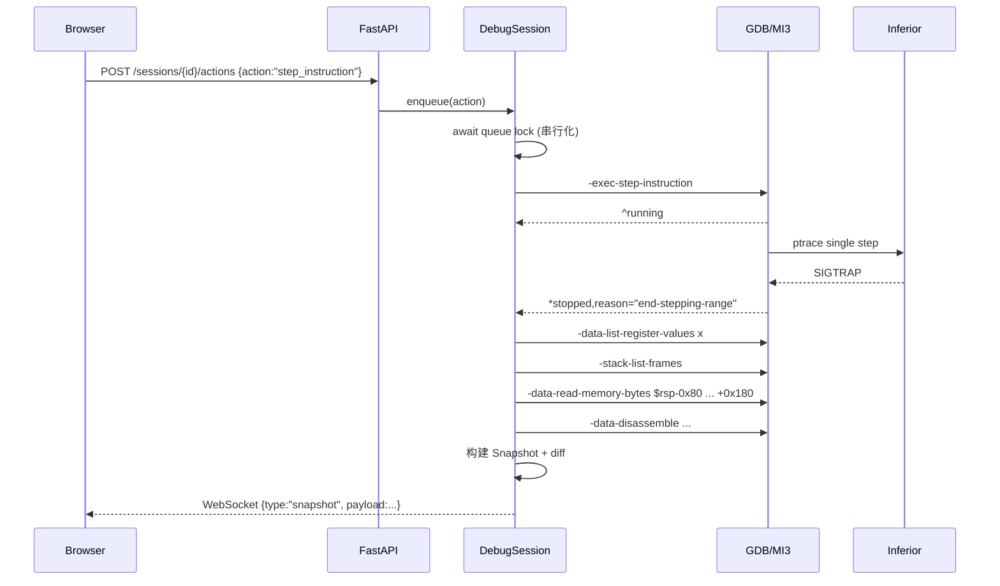

# 架构设计

本文档区分**已实现（Phase 0）**与**计划中（Phase 1+）**，避免把设计当成现状。

## 1. 进程与信任边界

```text
┌──────────────────────────── Windows 宿主 ────────────────────────────┐
│  Chromium 浏览器                                                     │
│    http://127.0.0.1:5173  (Vite dev server, 代理 /api 与 /health)     │
└───────────────────────────────┬──────────────────────────────────────┘
                                │ HTTP / WebSocket（本机回环）
┌───────────────────────────────▼──────────────────────────────────────┐
│  WSL2 Ubuntu 22.04                                                   │
│  FastAPI (uvicorn 127.0.0.1:8000)                                    │
│    api/  ── sessions/（Phase 1）                                     │
│                    │                                                 │
│                    ▼                                                 │
│           持久 GDB/MI3 子进程（pygdbmi，Phase 1）                     │
│                    │ ptrace                                           │
│                    ▼                                                 │
│           教学 ELF 进程（x86-64，本机可信）                            │
└──────────────────────────────────────────────────────────────────────┘
```

设计约束：

- 浏览器从不直接执行 GDB，也从不解析 GDB 文本；
- 后端是唯一能创建进程、发送 MI 命令的角色；
- 调试目标是本机教学样例，Phase 0/1 不接受任意路径的 ELF 上传；
- 前端只消费结构化 JSON，地址与 64-bit 值以十六进制字符串传输。

## 2. 已实现模块（Phase 0 + Phase 1）

### 2.1 后端

| 模块 | 职责 | 现状 |
|---|---|---|
| `app/main.py` | FastAPI 实例、CORS/Host/跨站护栏、异常处理、lifespan 日志与会话清理 | 已实现 |
| `app/core/config.py` | 环境变量 / `.env` → 不可变 `Settings`（含 GDB 参数、超时、快照/窗口限制） | 已实现 |
| `app/__main__.py` | 读取 `API_HOST`/`API_PORT` 启动 uvicorn（`python -m app`） | 已实现 |
| `app/core/proc.py` | 无 shell 的有界子进程执行（进程组超时 kill） | 已实现 |
| `app/core/errors.py` | 带稳定 `code` 的领域错误 → HTTP 错误体 | 已实现 |
| `app/core/security.py` | loopback 判定与非 loopback 绑定拒绝 | 已实现 |
| `app/debugger/environment.py` | 真实探测 GDB 版本、内嵌 Python、MI3、pwndbg 检测/加载 | 已实现 |
| `app/debugger/gdb_process.py` | 持久 GDB 子进程（独立进程组、Popen + pygdbmi IoManager） | 已实现 |
| `app/debugger/mi_controller.py` | MI token、命令 future、单 reader、异步事件队列、停止/退出状态 | 已实现 |
| `app/debugger/pwndbg_loader.py` | 可选 `source gdbinit.py`，失败仅 warning | 已实现 |
| `app/sessions/session.py` | 单会话状态机、串行化动作、快照、订阅推送 | 已实现 |
| `app/sessions/manager.py` | 会话注册表、数量上限、终止与 shutdown 清理 | 已实现 |
| `app/collector/*` | 寄存器、frames、RSP 内存分块、RIP 反汇编、快照组装 | 已实现 |
| `app/analysis/diff.py` | 按地址的字节级 diff + 寄存器 diff | 已实现 |
| `app/api/routes_sessions.py` | 会话 REST API | 已实现 |
| `app/api/websocket.py` | 单会话事件流（Origin/会话校验） | 已实现 |
| `app/samples/registry.py` | 扫描 `samples/*/demo.c`、读取 README、计算编译命令 | 已实现 |
| `app/api/routes_health.py` | `/health`，不启动 GDB | 已实现 |
| `app/api/routes_capabilities.py` | 聚合探测结果、架构判定、短 TTL 缓存、按需 pwndbg 验证、异常降级 | 已实现 |
| `app/api/routes_samples.py` | 样例列表与单样例查询 | 已实现 |
| `app/schemas/*` | Pydantic v2 响应模型（含 Snapshot/Session） | 已实现 |

探测是**真实执行**的：

```text
gdb --version
gdb --batch --nx --quiet -ex "python import sys; print('PWNVIZ_GDBPYTHON=' + ...)"
gdb --batch --nx --quiet --interpreter=mi3 -ex "python print('PWNVIZ_MI3_OK')"
gdb --batch --nx --quiet -ex "source <pwndbg>/gdbinit.py" -ex "python <marker>"
```

注意：GDB 12.1 对未知 `--interpreter` 也返回 0，因此 MI3 判定依赖标记输出并
拒绝 `unrecognized`，而不是只看退出码。

任何一步失败都只会产生 `available=false` / `status=load_failed` 与可读的
`warnings`，不会让健康检查或应用启动崩溃。

### 2.3 能力判定（ready）

```text
ready = gdb.available
        and gdb.version >= 12.1
        and gdb.supports_mi3
        and gdb.python.available
        and platform.is_x86_64
```

`platform.architecture` 由 `uname -m` 归一化：`x86_64`/`AMD64` → `x86-64`，
其他值原样返回且 `is_x86_64=false`（MVP 明确只支持 x86-64），此时 `ready=false`
并追加 warning。缺少 GDB 时同样只是 `ready=false`，HTTP 仍是 200。

### 2.2 前端

```text
src/
├── app/Workbench.tsx          3 栏 IDE 布局 + 底部 Dock + 状态栏
├── components/
│   ├── Toolbar/               目标选择、连接/就绪状态、动作按钮（Phase 2 接入 session）
│   ├── DisassemblyView/       占位：等真实快照
│   ├── StackMemoryView/       占位：展示计划中的地址行/字节格/图例
│   ├── RegisterPanel/         占位：寄存器名列表，无值
│   ├── MemoryInspector/       Phase 2 占位
│   ├── ExplanationPanel/      Phase 4 规则说明
│   ├── EnvironmentPanel/      真实探测结果（GDB/pwndbg/样例/警告）
│   └── BottomDock/            Environment / Memory / Diff / Explanation / Log 标签
├── hooks/useCapabilities.ts   探测请求、verify pwndbg、错误状态
├── hooks/useSamples.ts        样例列表
├── services/api.ts            类型化 fetch，统一错误映射
├── stores/sessionStore.ts     Zustand：选中样例、底部标签
└── types/api.ts               与后端 schema 对齐的类型
```

占位面板全部显式声明 “no live session / phase N”，不显示任何编造的寄存器或地址。

## 3. Phase 1 调试链路（已实现）

```text
app/debugger/
├── gdb_process.py      持久 GDB 子进程、stdin/stdout/stderr、独立进程组
├── mi_controller.py    单 reader、token→future、异步事件队列、stop/exit 纪元
└── pwndbg_loader.py    可选 source gdbinit.py，失败仅 warning

app/sessions/
├── manager.py          会话注册表、数量上限、terminate/shutdown
├── session.py          状态机 + asyncio.Lock 串行化 + 快照/订阅
└── state.py            CREATED/INITIALIZING/READY/RUNNING/STOPPED/EXITED/ERROR/TERMINATED

app/collector/
├── registers.py        -data-list-register-values x（按名称索引，fallback evaluate）
├── frames.py           -stack-list-frames（GDB unwinder，不假设 RBP）
├── memory.py           -data-read-memory-bytes（64B 分块，unreadable 容错）
├── disassembly.py      -data-disassemble -s ... -e ... -- 1
└── snapshot.py         组装不可变 Snapshot

app/analysis/diff.py    寄存器差异 + 按绝对地址的 stack byte diff

app/api/routes_sessions.py   会话 REST
app/api/websocket.py         /api/v1/sessions/{id}/stream
```

### 3.1 MI 并发与事件模型（实现要点）

- 每个 session 只有一个 reader 任务调用 pygdbmi `IoManager.get_gdb_response`；
- 命令以递增 token 写成 `<token>-exec-...`，`^done/^error/^running` 按 token
  解析并 resolve 对应 future；命令超时只丢弃该 future，**reader 继续运行**；
- `*running`/`*stopped`/`=thread-group-exited` 进入 `asyncio.Queue`，由 session
  事件循环消费并驱动状态机；即使 `*stopped` 比命令响应先到也不会丢；
- `stop_epoch` / `exit_epoch` 让动作可以捕获“命令发出前”的基线，等待新事件；
- 会话动作与快照采集共享同一把 session 锁，MI 写另有短锁，二者保证串行；
- `-exec-continue`/`-exec-interrupt` 返回后由事件循环异步完成 stop+snapshot；
- 步骤类动作在 HTTP 响应前等待对应 stop 与快照，避免前端拿到旧状态。

### 3.2 实测：`*stopped` 可能与命令响应同批到达

2026-11-03 用 pygdbmi + 真实 GDB 12.1 对 `samples/stack-basic/demo` 实测发现：

- `-exec-run` 的 `write()` 返回记录中同时包含 `^running`、`*running` 和 `*stopped`
  （`reason="breakpoint-hit"`）；
- 因此“命令返回后才可能收到 stopped”和“命令返回就代表已停止”两种假设都不成立。

Phase 1 的 MI controller 必须：

1. 为每条命令建立 future，按命令序号/token 关联 `^done` / `^error`；
2. 异步记录（`*running`、`*stopped`、`=thread-group-exited`）单独分发，即使它比
   命令响应先到，也要缓存并触发状态转换/快照；
3. 用状态机判断“进程已停止”，不能只看命令返回值。

该时序已由 `tests/integration/test_gdb_mi_smoke.py` 覆盖：先检查 `-exec-run` 的返回
记录里是否已有 stopped，没有才轮询后续异步记录。

### 3.3 单次 Step 的真实时序



关键规则：

- `^running` 只表示命令被接受，**不能**据此采集快照；
- 只有 `*stopped`（或 `=thread-group-exited`）事件之后才采集；
- 单个 reader 消费 pygdbmi 输出，命令 ID 与异步事件分区处理；
- 同一 session 的所有动作经 `asyncio.Lock` + 队列串行化；
- 快照 ID 单调递增，保留最近 200 个。

### 3.4 栈窗口

以 RSP 为中心：下方 0x80、上方 0x180，总长 ≤ 0x400，按 8 字节对齐。
分块读取，不可读块标记 `readable=false`，不允许整体失败。

### 3.5 数据真实性

- 寄存器：GDB MI 直接输出；
- 栈帧：GDB unwinder；
- 内存：GDB 读取的原始字节；
- 反汇编：GDB `-data-disassemble`；
- 变量名/类型：仅在 DWARF/GDB 变量对象可用时展示（Phase 4）；
- 解释：仅基于 before/after 实测，规则未覆盖时只陈述变化。

## 4. 前后端协议

Phase 1 已提供 REST + WebSocket：

| type | payload | 状态 |
|---|---|---|
| `session.state` | 状态变化、stop_reason、last_error | 已实现 |
| `snapshot` | 完整快照（寄存器、frames、stack、instruction、diff） | 已实现 |
| `debugger.error` | 命令/采集失败消息 | 已实现 |
| `session.terminated` | 清理完成 | 已实现 |
| `debugger.output` | 原始 MI 控制台文本 | 预留（控制器保留 recent output，不推流） |

地址一律十六进制字符串；字节用 2 位 hex 字符串或 `null`（不可读）；
时间 ISO-8601 UTC。

## 5. 非目标

- 不实现指令模拟器；
- 不把 pwndbg 终端输出当 API；
- 不假设 RBP 一定是帧指针；
- 不在未隔离时执行不可信 ELF；
- 不引入数据库、消息队列或微服务。
