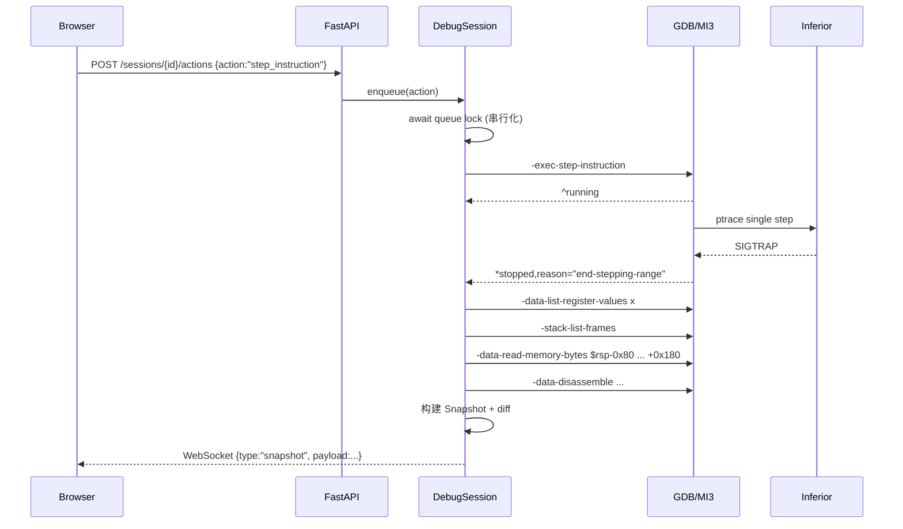

# 架构设计

本文档描述**当前已实现**的真实架构（V1.4），避免把设计当成现状。

## 1. 进程与信任边界

```text
┌──────────────────────────── Windows 宿主 ────────────────────────────┐
│  Chromium 浏览器                                                     │
│    http://127.0.0.1:5173  (Vite dev server, 代理 /api 与 /health)     │
└───────────────────────────────┬──────────────────────────────────────┘
                                │ HTTP / WebSocket（本机回环）
┌───────────────────────────────▼──────────────────────────────────────┐
│  WSL2 Ubuntu 22.04                                                   │
│  FastAPI (uvicorn 127.0.0.1:8000)                                    │
│    api/  ── sessions/                                               │
│                    │                                                 │
│                    ▼                                                 │
│           持久 GDB/MI3 子进程（pygdbmi）                             │
│                    │ ptrace                                           │
│                    ▼                                                 │
│           教学 ELF 进程（x86-64，本机可信）                            │
└──────────────────────────────────────────────────────────────────────┘
```

设计约束：

- 浏览器从不直接执行 GDB，也从不解析 GDB 文本；
- 后端是唯一能创建进程、发送 MI 命令的角色；
- 调试目标是本机教学样例，不接受任意路径的 ELF 上传；
- 前端只消费结构化 JSON，地址与 64-bit 值以十六进制字符串传输。

## 2. 已实现模块

### 2.1 后端

| 模块 | 职责 | 现状 |
|---|---|---|
| `app/main.py` | FastAPI 实例、CORS/Host/跨站护栏、异常处理、lifespan 日志与会话清理 | 已实现 |
| `app/core/config.py` | 环境变量 / `.env` → 不可变 `Settings`（含 GDB 参数、超时、快照/窗口限制） | 已实现 |
| `app/__main__.py` | 读取 `API_HOST`/`API_PORT` 启动 uvicorn（`python -m app`） | 已实现 |
| `app/core/proc.py` | 无 shell 的有界子进程执行（进程组超时 kill） | 已实现 |
| `app/core/errors.py` | 带稳定 `code` 的领域错误 → HTTP 错误体 | 已实现 |
| `app/core/security.py` | loopback 判定与非 loopback 绑定拒绝 | 已实现 |
| `app/debugger/environment.py` | 真实探测 GDB 版本、内嵌 Python、MI3、pwndbg 检测/加载 | 已实现 |
| `app/debugger/gdb_process.py` | 持久 GDB 子进程（独立进程组、Popen + pygdbmi IoManager） | 已实现 |
| `app/debugger/mi_controller.py` | MI token、命令 future、单 reader、异步事件队列、停止/退出状态 | 已实现 |
| `app/debugger/pwndbg_loader.py` | 可选 `source gdbinit.py`，失败仅 warning | 已实现 |
| `app/sessions/session.py` | 单会话状态机、串行化动作、快照、订阅推送 | 已实现 |
| `app/sessions/manager.py` | 会话注册表、数量上限、空闲 reaper、终止与 shutdown 清理 | 已实现 |
| `app/collector/*` | 寄存器、frames（带刷新策略）、批量 RSP 内存、带版本缓存的反汇编、变量对象缓存、快照组装（fast/full） | 已实现 |
| `app/analysis/diff.py` | 按地址的字节级 diff + 寄存器 diff | 已实现 |
| `app/analysis/perf.py` | 单调时钟 Profiler、MI 命令计数、阶段耗时、p50/p95 汇总 | 已实现 |
| `app/api/routes_sessions.py` | 会话 REST API | 已实现 |
| `app/api/websocket.py` | 单会话事件流（Origin/会话校验） | 已实现 |
| `app/samples/registry.py` | 扫描 `samples/*/demo.c`、读取 README、计算编译命令 | 已实现 |
| `app/api/routes_health.py` | `/health`，不启动 GDB | 已实现 |
| `app/api/routes_capabilities.py` | 聚合探测结果、架构判定、短 TTL 缓存、按需 pwndbg 验证、异常降级 | 已实现 |
| `app/api/routes_samples.py` | 样例列表与单样例查询 | 已实现 |
| `app/schemas/*` | Pydantic v2 响应模型（含 Snapshot/Session） | 已实现 |

探测是**真实执行**的：

```text
gdb --version
gdb --batch --nx --quiet -ex "python import sys; print('PWNVIZ_GDBPYTHON=' + ...)"
gdb --batch --nx --quiet --interpreter=mi3 -ex "python print('PWNVIZ_MI3_OK')"
gdb --batch --nx --quiet -ex "source <pwndbg>/gdbinit.py" -ex "python <marker>"
```

注意：GDB 12.1 对未知 `--interpreter` 也返回 0，因此 MI3 判定依赖标记输出并
拒绝 `unrecognized`，而不是只看退出码。

任何一步失败都只会产生 `available=false` / `status=load_failed` 与可读的
`warnings`，不会让健康检查或应用启动崩溃。

### 2.3 能力判定（ready）

```text
ready = gdb.available
        and gdb.version >= 12.1
        and gdb.supports_mi3
        and gdb.python.available
        and platform.is_x86_64
```

`platform.architecture` 由 `uname -m` 归一化：`x86_64`/`AMD64` → `x86-64`，
其他值原样返回且 `is_x86_64=false`（MVP 明确只支持 x86-64），此时 `ready=false`
并追加 warning。缺少 GDB 时同样只是 `ready=false`，HTTP 仍是 200。

### 2.2 前端

```text
src/
├── app/Workbench.tsx          3 栏 IDE 布局 + 底部 Dock + 状态栏
├── components/
│   ├── Toolbar/               目标、Run/Continue/Pause/StepI/NextI/Step Into/Step Over/Finish/Restart
│   ├── StatusBar/             Initializing/Running/Stopped/Exited/Error、RIP、breakpoint
│   ├── DisassemblyView/       快照反汇编、RIP 高亮、断点 marker、点击选择
│   ├── StackMemoryView/       地址/8 byte cells/qword/ASCII/RSP/RBP/changed/unknown
│   ├── RegisterPanel/         真实寄存器 + changed before→after
│   ├── VariablesPanel/        DWARF locals/args、array/struct/pointer/string
│   ├── MemoryInspector/       选中 byte 的地址、值、qword、ASCII、pointer target
│   ├── DiffPanel/             寄存器与绝对地址字节级 diff
│   ├── ExplanationPanel/      有限规则 + 实测 before/after，不模拟未知指令
│   ├── EnvironmentPanel/      真实探测结果（GDB/pwndbg/样例/警告）
│   ├── DebugLogPanel/         GDB/MI 输出、WS/action 事件
│   └── BottomDock/            Memory / Variables / Diff / Explanation / Log / Environment
├── hooks/useCapabilities.ts   探测请求、verify pwndbg、错误状态
├── hooks/useSamples.ts        样例列表
├── i18n/                      i18next 初始化 + locales/{zh-CN,en-US}/ 七个命名空间
├── components/common/LanguageSwitch.tsx  中英切换（无需刷新）
├── lib/address.ts             地址解析/格式化/比较（BigInt，无 Number 地址）
├── lib/snapshot.ts            同一 snapshot 派生 marker/选中 cell/previous 值
├── lib/explain.ts             push/pop/mov/sub rsp/add rsp/call/ret/leave/nop（可注入翻译）
├── lib/virtualWindow.ts       固定行高虚拟窗口（>200 行才启用）
├── lib/renderPerf.ts          React Profiler 环形缓冲（StackMemoryView）
├── services/api.ts            REST + WebSocket URL，统一错误映射（code+params）
├── stores/debugStore.ts       Zustand 单一 debug 状态 + WS 重连/去重/状态单调性
└── types/api.ts, debug.ts     与后端 schema 对齐的类型（含 perf / 缓存状态）
```

数据一致性：

- 组件不维护独立 register/stack 状态；全部从 `debugStore.snapshot` /
  `previousSnapshot` / `history` 派生；
- RSP/RBP marker 不使用后端 `annotations` 作为事实，而是用
  `snapshot.registers` + BigInt 地址计算行与 byte offset；不在窗口时显示
  “outside the current stack window”；
- 地址仅作为十六进制字符串存储；排序/比较用 BigInt；`snapshot_id` 等非地址
  计数才使用 Number；
- `diff.changed_bytes` 的绝对地址用于 byte cell 高亮，动画 220ms，可关闭；
- WS/REST 快照按 `snapshot_id` 去重，避免同一快照重复渲染/闪烁；
- 无 snapshot 时显示 empty state，不展示 fixture/伪造寄存器值；
- V1.1 渲染层：`ByteCell` / `StackRowView` 用 `React.memo` + 原始值 props，
  行模型每张快照只构建一次；`StackMemoryView` / `DisassemblyView` /
  `RegisterPanel` 自身 `memo`，避免 Workbench 因无关状态重建子樹；
  栈行数 > 200 时才启用虚拟滚动（默认 64 行完整渲染）。

### 2.4 V1.3 StackMap：缩放、归属验证与外部标注（已实现）

**缩放坐标系**（`lib/stackMap.ts` + `StackMapCanvas.tsx`）：

- `buildStackMap(snapshot, pxPerByte)` 是唯一布局入口；默认
  `STACK_MAP_PX_PER_BYTE = 10`（实际比例 100%），钳制在 [1, 120]；
- 三种缩放模式只决定 pxPerByte 的取值来源：`actual` 固定 10；
  `fit-frame` 用当前帧真实字节数推导（`fitFramePxPerByte`）；
  `fit-stack` 用整个栈窗口字节数推导（`fitStackPxPerByte`）；
- 所有 Y 坐标都来自 `addressTop(model, address)` =
  `(windowEnd - address) * model.pxPerByte`：内存块、地址标尺、
  PointerArrow、RSP/RBP Marker、变化高亮共用同一函数，
  因此任何缩放下地址映射零偏移；块高 = 真实字节数 × pxPerByte；
- 缩放百分比相对实际比例（10px/byte = 100%），重置回 `actual`；
  选择持久化在 `localStorage["pwnviz.stackZoom"]`。

**变量归属三态验证**（`annotateVariableFrames`）：

```text
verified   = GDB frame_level 与包含该地址的已证帧一致
             （或：叶函数红区——地址在帧基址之下、RSP-128B 之上、
               且不与其他已证帧重叠；GCC12 -O0 叶函数不发 sub rsp）
conflict   = 声明的帧可见但地址证据矛盾（在其他帧范围内 / 超出合理区域）
             → 变量按真实地址绘制 + ⚠，绝不进入任何帧的变量列表
unresolved = 证据不足（声明的帧不在窗口 / 无 frame_level / 地址无帧可归）
             → 按真实地址绘制 + ?，不猜测
```

- 归属绝不根据变量名称推断；`model.variableAssignments[]` 保留
  claimed/geometric level 与 reason，供悬停卡与头部徽章展示；
- 窗口内但不在任何已证帧内的变量进入 `unframedBlocks`，按真实地址
  独立绘制（V1.2 及之前会被静默丢弃）。

**微型块外部标注**（`layoutGutterAnnotations`）：

- 块高 `< 26px`（1–2 真实字节）时块内不放任何文字；变量名以芯片形式
  画在帧标签列，芯片防重叠纵向排列并用引线指向块的真实中心；
- 悬停任意块弹出 `BlockHoverCard`（名称/类型/真实值/地址范围/大小/归属证据），
  `pointer-events-none` 不拦截点击；点击块打开底部 Inspector。

**帧标题板**：`StackFrameCard` 的帧名是固定 88px 的标题板，位于帧标签列
（地址轴之外），小帧也完整展示；`data-state = current | verified | warning`。

**课堂投屏模式**：`debugStore.projectionMode`（`pwnviz.projection` 持久化）；
隐藏 StatusBar/会话 ID/开发模式入口，教学区收成单行；演示面字号 ≥12px。

**以栈为中心的列组几何（V1.4）**：`STACK_MAP_COLUMN_GROUP` =
标尺 160 + Diff Gutter 12 + 内存柱 320（上限 360）+ 标记区 88 = 580px，
在 StackMap 工作区内居中（`groupLeft = max(8, (contentWidth-580)/2)`）；
真实字节几何只映射高度，宽度固定。帧 = 柱内纵向段；函数名/微变量芯片为
柱上覆盖标签；指针箭头路由到列组右侧留白（lane 数随可用宽度自适应）；
RSP/RBP 标记在柱右侧 88px 区，短箭头指向真实行；Inspector Drawer
（选中内存块时浮出）承载原底部面板的全部细节；
PresentationWorkbench 网格 26/56/18，演示模式唯一讲解为 CurrentInstruction。

**指针正交路由（V1.3.1）**：`assignPointerLanes()` 在过滤掉 NULL/窗外/不可读
链接**之后**按 Y 序分配连续 0..n-1 通道；`pointerLaneWidth(n)` 按可见数动态
计算路由宽度（18px/通道，上限 12 条）；`PointerArrow` 为正交折线
（出块→独立通道垂直→入目标，圆角），同块出口/同目标入口按 6px 错开并钳制在
块真实范围内——任何两条可见箭头不共用 lane X 或控制点。
Presentation 默认只绘制与选中块相关的指针（无选中不画），HeaderBar
"全部指针" 开关（`pwnviz.showAllPointers` 持久化）显示全部真实关系。

**自适应标尺（V1.3.1）**：`buildRulerTicks(windowStart, windowEnd, pxPerByte, mode)`
按缩放与模式选择步长——presentation 主刻度间距 ≥56px 且无次刻度；
developer 8/16/32B 且次刻度仅在 ≥14px 时生成；刻度 Y 仍走 `addressTop()`。

**纯色色带（V1.3.1）**：`stack-map-unknown/unreadable/quiet/above` 全部为
纯色填充（unreadable 保留左侧红色标记），不再使用 repeating-linear-gradient。

**逐字节变化标记（V1.3.1）**：`MemoryChangeOverlay` 按 `diff.changed_bytes`
真实地址在块内逐字节定位左缘标记，tooltip 携带 `before → after`；变量显示
changed count；底部 Inspector 列出选中块的 before/after；不再整块覆盖。

**Diff Gutter 与合并竖标（V1.3.2）**：`groupMemoryChangesByAddress()` 把
`diff.changed_bytes` 按连续地址合并（每字节 before/after 保留）；
块内变化 = 左缘 4px 合并竖标（`MemoryChangeOverlay`）；未归属变化 =
标尺旁 18px Diff Gutter 里的 4px 竖标（点击 → Inspector 的
Address|Before|After 表格）；全宽横线绘制方式已删除。

**视觉回归**：两个 Playwright 套件驱动真实 GDB——
`frontend/e2e/presentation.visual.spec.ts`（教学检查点 7 项，截图
`docs/assets/presentation/`）与 `frontend/e2e/stackmap-clarity.spec.ts`
（清晰度 7 项，截图 `docs/assets/stackmap-v1.3.1/`）；共享会话助手
`frontend/e2e/gdb.ts`。运行 `scripts/run_visual_tests.sh`
（WSL 后端 + Vite + Playwright）。

### 2.5 V1.4 以栈为中心的演示布局（已实现）

**PresentationWorkbench**：三栏 `minmax(340px,26fr) / minmax(620px,56fr) /
minmax(260px,18fr)`（1920×1080 下源码/汇编、StackMap 工作区、核心寄存器
≈ 26/56/18）；<1280px 时寄存器折叠为 `<details>`；无固定底部面板。

**StackMapCanvas 列组**（居中，宽度固定 580px）：

```text
┌────────────┬──────┬────────────────────────────┬──────────┐
│ 地址标尺    │ Diff │        内存柱 (Spine)       │ RSP/RBP  │
│   160px    │ 12px │         320px (≤360)        │  88px    │
│ 左对齐地址  │ 未归属 │ 帧纵向段 / 变量块 / 返回地址 │ 短箭头   │
└────────────┴──────┴────────────────────────────┴──────────┘
        groupLeft = max(8, (contentWidth − 580) / 2)
```

- 真实字节几何只映射高度（`addressTop()` 单一坐标函数）；柱宽固定，
  不随容器拉伸，两侧留白；指针箭头路由到列组右侧留白（lane 数随宽度自适应）；
- **StackFrameCard** = 柱内纵向段：顶部小型函数名标签（current 青色 /
  verified 次级 / warning 琥珀，点击定位）、变量块、saved RBP、返回地址；
  微变量芯片叠柱左缘（`layoutGutterAnnotations` 防重叠）；
- **RSP/RBP 标记**（`StackPointerMarker`）在柱右侧 88px 区：短箭头指向
  真实地址行，点击定位；RSP===RBP 时标签错开、锚点不动；跨柱横线仅在
  developer 模式或用户点击后临时出现；
- **InspectorDrawer**：选中内存块/变化区时从右侧浮出（不占常驻空间），
  承载内存 diff、选中块详情（类型/大小/`rbp-0x14` 偏移/原始字节 32/
  QWORD/ASCII/指针目标）与 Address|Before|After 表格；
  **不含执行解释** —— CurrentInstruction 是唯一教学解释表面
  （指令/地址/函数/一句实测结果）；DeveloperWorkbench 保留完整 BottomDock。

## 3. 调试链路（已实现）

```text
app/debugger/
├── gdb_process.py      持久 GDB 子进程、stdin/stdout/stderr、独立进程组
├── mi_controller.py    单 reader、token→future、异步事件队列、stop/exit 纪元
└── pwndbg_loader.py    可选 source gdbinit.py，失败仅 warning

app/sessions/
├── manager.py          会话注册表、数量上限、idle reaper、terminate/shutdown
├── session.py          状态机 + asyncio.Lock 串行化 + 快照/订阅
└── state.py            CREATED/INITIALIZING/READY/RUNNING/STOPPED/EXITED/ERROR/TERMINATED

app/collector/
├── registers.py        -data-list-register-values x（按名称索引，fallback evaluate）
├── frames.py           -stack-list-frames（GDB unwinder，不假设 RBP）
├── memory.py           -data-read-memory-bytes（64B 分块，unreadable 容错）
├── disassembly.py      -data-disassemble -s ... -e ... -- 1
├── variables.py        GDB variable objects：locals/args/types/children/pointer target
└── snapshot.py         组装不可变 Snapshot

app/analysis/diff.py    寄存器差异 + 按绝对地址的 stack byte diff

app/api/routes_sessions.py   会话 REST
app/api/websocket.py         /api/v1/sessions/{id}/stream
```

### 3.1 MI 并发与事件模型（实现要点）

- 每个 session 只有一个 reader 任务调用 pygdbmi `IoManager.get_gdb_response`；
- 命令以递增 token 写成 `<token>-exec-...`，`^done/^error/^running` 按 token
  解析并 resolve 对应 future；命令超时只丢弃该 future，**reader 继续运行**；
- `*running`/`*stopped`/`=thread-group-exited` 进入 `asyncio.Queue`，由 session
  事件循环消费并驱动状态机；即使 `*stopped` 比命令响应先到也不会丢；
- `stop_epoch` / `exit_epoch` 让动作可以捕获“命令发出前”的基线，等待新事件；
- 会话动作与快照采集共享同一把 session 锁，MI 写另有短锁，二者保证串行；
- `-exec-continue`/`-exec-interrupt` 返回后由事件循环异步完成 stop+snapshot；
- 步骤类动作在 HTTP 响应前等待对应 stop 与快照，避免前端拿到旧状态；
- inferior 退出后自动关闭 GDB；reader 永久失败会置 ERROR 并关闭控制器；
  异常退出时按 `/proc` starttime 校验后清理可能残留的 inferior。

### 3.2 实测：`*stopped` 可能与命令响应同批到达

2026-11-03 用 pygdbmi + 真实 GDB 12.1 对 `samples/stack-basic/demo` 实测发现：

- `-exec-run` 的 `write()` 返回记录中同时包含 `^running`、`*running` 和 `*stopped`
  （`reason="breakpoint-hit"`）；
- 因此“命令返回后才可能收到 stopped”和“命令返回就代表已停止”两种假设都不成立。

MI controller 的硬性要求：

1. 为每条命令建立 future，按命令序号/token 关联 `^done` / `^error`；
2. 异步记录（`*running`、`*stopped`、`=thread-group-exited`）单独分发，即使它比
   命令响应先到，也要缓存并触发状态转换/快照；
3. 用状态机判断“进程已停止”，不能只看命令返回值。

该时序已由 `tests/integration/test_gdb_mi_smoke.py` 覆盖：先检查 `-exec-run` 的返回
记录里是否已有 stopped，没有才轮询后续异步记录。

### 3.3 单次 Step 的真实时序



关键规则：

- `^running` 只表示命令被接受，**不能**据此采集快照；
- 只有 `*stopped`（或 `=thread-group-exited`）事件之后才采集；
- 单个 reader 消费 pygdbmi 输出，命令 ID 与异步事件分区处理；
- 同一 session 的所有动作经 `asyncio.Lock` + 队列串行化；
- 快照 ID 单调递增，保留最近 200 个。

### 3.4 栈窗口

以 RSP 为中心：下方 0x80、上方 0x180，总长 ≤ 0x400，按 8 字节对齐。

V1.1 起默认用**一条** `-data-read-memory-bytes` 读取整个 0x200 窗口
（`PWNVIZ_MEMORY_BATCH_MAX_BYTES`，默认 0x400）。窗口大于上限时自动分段；批量命令
失败或只返回部分字节时，自动降级为 0x40 分块读取并只对缺失区间抢救。不可读块标记
`readable=false` 并列入 `unreadable_ranges`，**不允许整体失败，也不允许写成 0**。
`perf.memory_batch_reads / memory_chunk_reads / memory_degraded` 记录真实读取路径。

### 3.5 数据真实性

- 寄存器：GDB MI 直接输出；
- 栈帧：GDB unwinder；
- 内存：GDB 读取的原始字节；
- 反汇编：GDB `-data-disassemble`；
- 变量名/类型/值/地址：GDB/MI variable objects，要求 DWARF；
  `source=dwarf, confidence=debug-info`；array/struct children 来自
  `-var-list-children`；optimized out/synthetic/register 明确标记；
- pointer target：单层、最多 64B 的 GDB 内存读取，`target_source=gdb-memory`；
  不自动跟随指针链，不超出读取上限；
- 无 DWARF：变量列表为空，raw stack/registers 不受影响；
- 解释：仅基于 before/after 实测，规则未覆盖时只陈述变化。

### 3.6 V1.1 两级采集：Fast Snapshot 与 Full Snapshot

| 模式 | 何时使用 | 采集内容 | 不采集 |
|---|---|---|---|
| `fast` | 每次单步、continue 后的普通停止 | 寄存器、栈内存 + diff、当前指令（缓存反汇编）、缓存帧（显式标注）、`-var-update` 增量变量 | 不重建变量树、不重复 unwind/反汇编 |
| `full` | `launch`、`POST /refresh`、`mode="full"` 的动作 | 强制 unwind、重新取反汇编窗口、完整变量收集/增量更新 | — |

- 初始快照固定 `full`，保证第一屏就有真实局部变量；
- `PWNVIZ_SNAPSHOT_MODE` 可改默认模式，`ActionRequest.mode` 可按动作覆盖；
- 帧实例变化时 Fast 也会重建该帧的变量对象（否则没有正确数据可展示），
  这是唯一例外，且只发生在进出函数时；
- 快照新增字段：
  `mode`、`frames_state`、`frames_stale`、`frames_version`、
  `variables_state`、`variables_stale`、`variables_version`、`perf`。
  旧客户端可忽略这些字段。

### 3.7 变量对象缓存与 `-var-update`

`app/collector/variables.py` 持有 `VariableCache`：

- 变量对象跨快照保留，不再每步 `-var-create`/`-var-delete`；
- 同帧刷新用 `-var-update --all-values *`（1 条命令）；
- 复合类型用 `-var-list-children --all-values` 刷新子值；
- 指针值变化时清空旧目标字节并按预算重读；未重读的标记 `target_source="cache"`；
- 帧实例变化、变量名集合变化、`in_scope=false`、`type_changed=true`、
  超出对象预算（默认 192）时删除旧对象并重建；
- 会话终止时删除全部变量对象；
- 每个节点保留 `source` / `confidence`。

状态：`full` / `updated` / `cached` / `deferred` / `unavailable`，语义见
[docs/PERFORMANCE.md §3.3](PERFORMANCE.md)。

### 3.8 反汇编窗口缓存

- 抓取时同时记录指令文本、地址、函数、**每条指令的真实字节**和抓取快照号；
- RIP 在窗口内且位于已知指令边界 → 0 条命令；
- RIP 离开窗口或落到未知边界 → 重新抓取；
- `perf.disassembly_source`（`gdb`/`cache`/`none`）与
  `perf.disassembly_version` 可审计。

### 3.9 帧刷新策略（证据驱动）

刷新条件：动作为 `finish`/`continue`/`launch`/`step`/`next`；刚执行
`call`/`callq`/`ret`/`retq`；stop reason 为 `breakpoint-hit` 等；或达到
`PWNVIZ_FRAME_REFRESH_INTERVAL`（默认 12）张快照的安全上限。

**不使用 RBP 判断帧变化。** 未刷新时 `frames_state="cached"`、
`frames_stale=true`。变量缓存失效使用帧身份
`(level, function, file, 帧数, 调用者返回地址)`；当前 PC 不参与身份判断。

### 3.10 性能采集

- `PerfRecorder` 用单调时钟记录寄存器/帧/反汇编/内存/变量/diff 六个阶段；
- `MIController.perf` 记录每条命令的耗时与计数（含超时/失败命令）；
- 会话层在发布前测量 `model_dump + json.dumps` 与 payload 字节数
  （`serialize_ms`、`payload_bytes`），WebSocket 端点在 `send_json` 后记录真实
  发送耗时（`ws_send_ms`）；
- `GET /api/v1/sessions/{id}/performance` 返回最近一次 + 最近 20 次 + 聚合；
- 详细数据与对比见 [docs/PERFORMANCE.md](PERFORMANCE.md)。

## 4. 前后端协议

REST + WebSocket（已实现）：

| type | payload | 状态 |
|---|---|---|
| `session.state` | 状态变化、stop_reason、last_error | 已实现 |
| `snapshot` | 完整快照（寄存器、frames、stack、instruction、diff） | 已实现 |
| `debugger.error` | 命令/采集失败消息 | 已实现 |
| `debugger.output` | GDB/MI 可读输出，`stream` + `text` + 单调 `seq` | 已实现 |
| `breakpoints.updated` | 初始断点列表 | 已实现（暂无增删 API） |
| `session.terminated` | 清理完成 | 已实现 |

V1.1 的 `snapshot.payload` 增加（均为可选，旧客户端忽略）：

| 字段 | 类型 | 说明 |
|---|---|---|
| `mode` | `"fast" \| "full"` | 采集模式 |
| `frames_state` / `frames_stale` / `frames_version` | string / bool / int | 帧是本次读取还是缓存 |
| `variables_state` / `variables_stale` / `variables_version` | string / bool / int | 变量完整/增量/缓存/延迟 |
| `perf` | object | 阶段耗时、MI 命令数、payload 字节、序列化耗时 |

新增 REST：

| Method | Endpoint | 说明 |
|---|---|---|
| POST | `/api/v1/sessions/{id}/refresh` | 不执行指令，重新采集当前停止点（帧/反汇编/变量） |
| GET | `/api/v1/sessions/{id}/performance` | 最近一次 + 最近 20 次 + p50/p95 聚合 |

错误体新增可选的 `params`（稳定 code 的结构化参数），见
[docs/I18N.md §5](I18N.md)。

快照消息按 `snapshot_id` 单调接受；较小 id 不覆盖当前快照。输出消息按 `seq`
去重。状态更新在客户端做终态单调保护（EXITED/ERROR/TERMINATED 不被晚到的
RUNNING/STOPPED 覆盖）。

地址一律十六进制字符串；字节用 2 位 hex 字符串或 `null`（不可读）；
时间 ISO-8601 UTC。

## 5. 非目标

- 不实现指令模拟器；
- 不把 pwndbg 终端输出当 API；
- 不假设 RBP 一定是帧指针；
- 不在未隔离时执行不可信 ELF；
- 不引入数据库、消息队列或微服务；
- 不为了性能减少真实数据（快照永远不会用 mock、零填充或「上次的值」冒充当前值；
  缓存一定有显式状态字段）。
