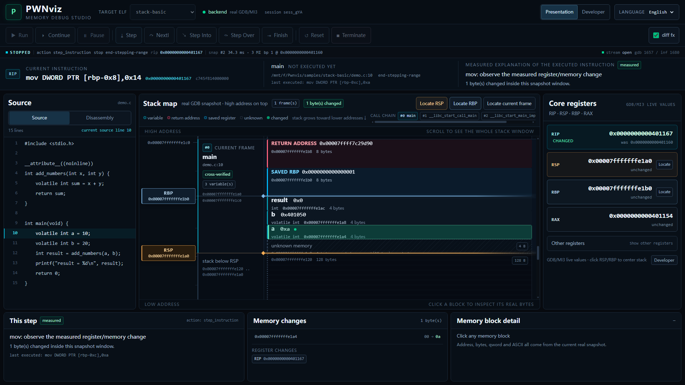
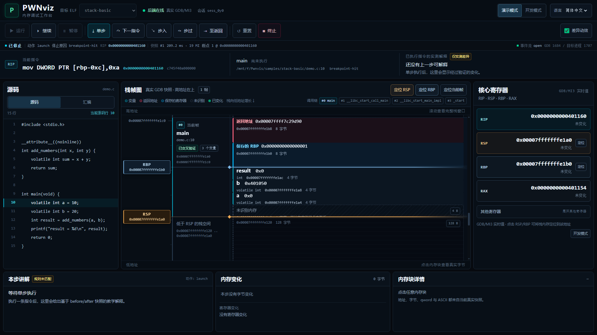
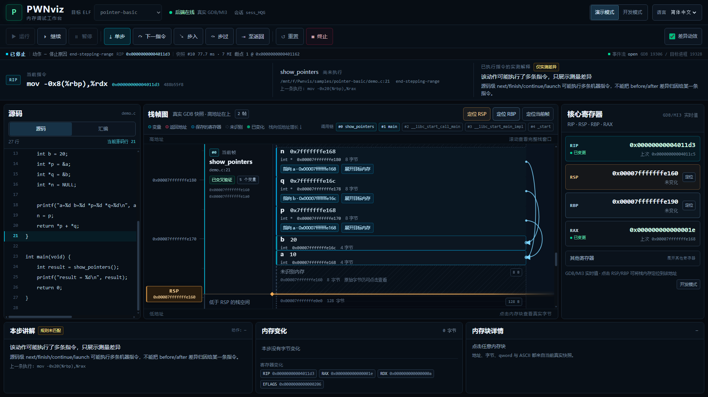
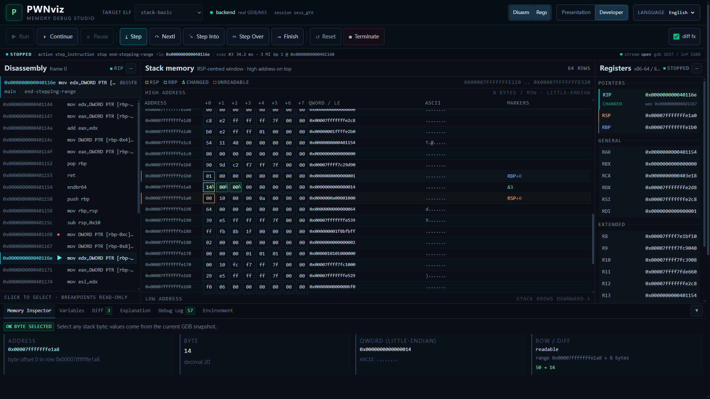
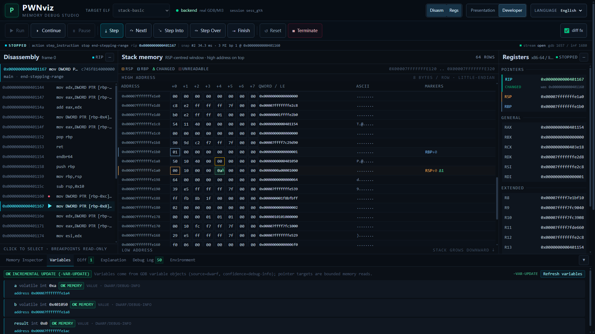

# PWNviz V1.2 — 图形化栈帧教学工作台（UI 文档）

> 更新日期：2026-11-05  
> 适用范围：`frontend/src`、`samples/pointer-basic`、`scripts/ui_smoke.mjs`  
> 设计目标：从“缩小的 IDE”改成“先看内存布局，再理解地址与字节”的投屏教学工作台。











---

## 1. 两种模式，一个数据源

| 模式 | 入口 | 布局 | 适合 |
|---|---|---|---|
| Presentation（默认） | 顶栏“演示模式” | 源码/汇编 · **栈帧图（约 60% 宽度）** · 核心寄存器；底部单步讲解/内存变化/选中块 | 1920×1080 投屏 |
| Developer | 顶栏“开发模式” | 保留原 DisassemblyView / StackMemoryView / RegisterPanel / BottomDock | 深入排查 |

- 两种模式只用同一个 `useDebugStore`、同一份真实 Snapshot、同一套 REST/WS。
- 模式保存在 `localStorage["pwnviz.mode"]`，刷新后保留；默认 `presentation`。
- 语言仍由 i18next 管理，默认 `zh-CN`，`localStorage["pwnviz.locale"]`。
- 演示模式没有第二套 mock 数据；没有会话时只显示明确的空状态。

### 页面结构（1920×1080）

```text
HeaderBar        64–68px   Logo · 目标 ELF · 后端/会话 · 模式切换 · 语言
ExecutionBar     62–63px   Run/Continue/Pause/Step/NextI/Step Into/Step Over/Finish/Reset/Terminate
StatusBar        32px      state · action · stop reason · RIP · snapshot · perf · breakpoints · stream
CurrentInstruction 82px   当前 RIP 指令 + 函数/源码行 + 上一条已执行指令的实测解释
Main workspace   flex     左：源码/汇编；中：StackMapCanvas；右：核心寄存器
StepTeachingPanel 168–200px 本步讲解 · 内存变化 · 选中内存块
```

开发模式复用同一 Header/Execution/Status，下面换成原有三栏 + BottomDock。

---

## 2. 字体与可读性基线

| 元素 | 字号 |
|---|---|
| 页面正文 / 面板正文 | 13–14px |
| 面板标题 | 18px（演示/开发统一） |
| 栈帧函数名 | 16px |
| 变量名称 | 16px |
| 变量值 | 16px（寄存器卡片 18px） |
| 内存地址 | 12–14px（标尺 12px、块内 12px、帧范围 11px 辅助） |
| Byte Cell（开发模式） | 14px，行高 30px |
| 普通按钮 | 40–46px 高 |
| 重要操作按钮 | 46px 高 |

演示模式不再出现大面积 8/9/10px 正文；开发模式保留少量密集元数据，并通过
`.developer-chrome` 的作用域覆盖把旧的 7–12px 工具类统一提升到 11.5–14px。

---

## 3. StackMapCanvas：图形化栈帧图

```
┌──────────────┬──────────────────┬─────────────────────────────────────┬──────────┐
│ 地址标尺 164 │ 栈帧标签 184      │ 内存块（真实地址轴）                  │ 指针连线  │
│ 真实地址刻度  │ 函数名/文件/帧角色 │ 变量 / 返回地址 / 保存 RBP / 未识别   │ 76px     │
└──────────────┴──────────────────┴─────────────────────────────────────┴──────────┘
                         高地址在上，低地址在下；1 字节 = 10px
```

### 3.1 组件目录

`frontend/src/components/StackMap/`

| 文件 | 职责 |
|---|---|
| `StackMapCanvas.tsx` | 数据模型构建、滚动/定位、图例、调用链、指针 SVG 叠加层、选中/悬停 |
| `StackFrameCard.tsx` | 单个栈帧容器；独立函数名/文件/帧角色/验证状态；粘性帧标签 |
| `MemoryBlock.tsx` | 通用内存块：变量/返回地址/保存 RBP/未识别/不可读/低于 RSP |
| `VariableBlock.tsx` | 变量块的名称、类型、值、地址、大小、参数/指针标记 |
| `AddressRuler.tsx` | 左侧真实地址标尺（每 8 字节刻度、每 16 字节标签） |
| `StackPointerMarker.tsx` | RSP（橙）/RBP（蓝）精确地址线 + 可点击 chip |
| `PointerArrow.tsx` | SVG 三次曲线 + 箭头 + 命中区域 + 悬停高亮 |
| `MemoryChangeOverlay.tsx` | 460ms 绿色变化提示；`prefers-reduced-motion` 下退化为静态底色 |

纯布局计算在 `frontend/src/lib/stackMap.ts`，并由
`frontend/src/lib/stackMap.test.ts` 覆盖；组件不承担地址推断。

### 3.2 栈帧边界如何得到（真实性规则）

1. **正常路径**：从 RBP 开始沿帧指针链走。每一步都必须同时满足：
   - `[RBP]` 是可读的、8 字节对齐的更高栈地址；
   - `[RBP + 8] == snapshot.frames[level + 1].address`（GDB unwinder 的调用者 PC）。
   只有内存里的保存 RIP 与 unwinder 完全一致，才把这段内存画成该栈帧的边界。
2. **入口帧**：当函数刚被 `call`、还没 `push rbp` / `mov rbp,rsp` 时：
   - 在 `[RSP, RSP+0x18)` 中找到与 `frames[1].address` 完全相等的 qword，作为已确认的返回地址槽；
   - 若紧邻其下（`RSP`）的 qword 等于当前 RBP，才标记为“保存的 RBP”；
   - 调用者帧只有在 `[RBP+8]` 等于 `frames[2].address` 时才绘制。
3. **无帧指针 / 无法验证**：只画从 RSP 向上的当前区域，帧标签明确写
   “入口帧：返回地址已实测确认”或“帧边界未知”；绝不使用 `RBP - RSP` 猜变量位置。
4. **变量**：只把 DWARF 提供真实地址的变量放入内存轴；地址在窗口外的不画块，
   放在“窗口外变量”提示里。
5. **帧外区域**：`below-rsp` / `above-frames` 是真实可读内存，但明确不归属任何
   已知帧；未识别块不命名成局部变量。
6. 后端在会话启动时执行 `set backtrace past-main on`，否则 GDB 默认停在 `main`，
   拿不到 `__libc_start_call_main` 等调用者，无法交叉验证 main 的边界。

### 3.3 变量大小

- 后端新增 `VariableNode.size_bytes`，由 GDB `-data-evaluate-expression sizeof(<path>)`
  实测（见 `backend/app/collector/variables.py`）。
- 前端优先使用 `size_bytes`；没有时只对基本类型/数组按 x86-64 ABI 推断，并在块内
  标注 `≈ ABI`；struct/union/未知类型显示“大小未知（仅标注地址）”。
- 内存块高度 = `size_bytes × 10px`；地址/间隙均由真实地址差计算，不为了美观改地址。

### 3.4 指针连线

- 只有 `pointer_target` 与某个已知块地址**精确相等**（或落在其内部）才画实线。
- `NULL` 显示 `NULL`，不画线。
- 目标在栈窗口内但没有已知块：虚线 + “未解析”。
- 目标在栈窗口外/不可读：块内 chip 标明“栈窗口外/目标不可读”，点击仍可展开后端
  已读取的有界目标字节（最多 64B）。
- 悬停指针块或箭头会同时高亮指针与目标；目标块有细蓝环。
- 点击箭头或“展开目标内存”调用 `jumpToPointer(node)`，选中真实目标地址，
  并把目标字节放入底部“内存块详情”。

### 3.5 单步变化与动画

- 一次真实 GDB 单步后，`snapshot.diff.changed_bytes` 直接驱动：
  - 变化字节所在 block 的绿色 overlay；
  - 不在已知块内的变化字节，画绿色标记线；
  - RSP/RBP 寄存器的上一个值/变化状态；
  - 底部“内存变化”逐字节 `before → after`。
- 动画 460ms、无粒子/无整页闪烁；`animationsEnabled=false` 或
  `prefers-reduced-motion: reduce` 时不动画。动画只读当前快照，不延迟 store 更新。
- 栈帧结构变化时（call/ret/step-into/return）自动聚焦新帧；同一帧内普通指令
  不重置用户滚动位置。

---

## 4. 演示模式各面板

### 左侧：源码 / 汇编

- 源码来自 `GET /api/v1/samples/{id}/source`，只读真实文件；当前 DWARF 行高亮并自动居中。
- 汇编使用真实 `snapshot.disassembly`；当前 RIP 青色高亮，断点只读标记。
- 接口不可用时明确显示“源码不可用”，不生成假源码。

### 中间：StackMapCanvas

- 顶部：标题、真实快照提示、帧数、变化字节数、定位 RSP/RBP/当前帧。
- 图例 + 调用链（来自 GDB unwinder，点击可定位对应帧）。
- 高/低地址边界、真实地址标尺、可滚动内存轴。
- 帧数通常为 1–2；更多调用者在调用链里，只有窗口内有可验证边界的帧才画容器。

### 右侧：核心寄存器

- RIP / RSP / RBP / RAX 独立卡片，显示当前值、上一次值、变化状态。
- 点击 RSP/RBP 通过共享 `scrollTarget` 定位栈图；点击 RIP 选中当前指令。
- 其他寄存器在 `<details>` 中折叠；演示模式只保留核心四张卡。

### 底部：本步讲解 / 内存变化 / 内存块详情

- 讲解只来自 `explainStep()` 的实测 before/after；规则未匹配时明确标注。
- `push rbp` 会追加“将当前 RBP 的当前值压入栈中，RSP 向低地址移动 8 字节”；
  `mov rbp,rsp` 会追加“新的 RBP = 上一条指令后的 RSP（实测值），建立新的栈帧基址”；
  `sub rsp, N` 会追加“为当前函数预留 N 字节栈空间”，均以 RSP/内存实测一致为前提。
- 内存变化列出真实地址与 `before → after`，点击定位。
- 选中块显示地址、大小、值、原始字节、qword、ASCII；指针目标单独显示。
- 开发者模式仍使用完整 MemoryInspector / Variables / Diff / Explanation / Debug Log。

---

## 5. 开发模式保留与放大

- 保留 `DisassemblyView`、`StackMemoryView`、`RegisterPanel`、`BottomDock`
  以及所有原有 test id；开发模式 header 增加 Disasm/Regs 折叠按钮。
- 字节表：30px 行高、14px byte cell、12.5px 地址/qword/ascii，虚拟滚动阈值仍为 200 行。
- 底部 dock：40px 标签栏、14px 正文、24vh 内容高度；所有原有 tab 与功能不变。
- 原有断点、日志、diff、选中与滚动行为不变。

---

## 6. 验证记录（V1.2）

```text
Backend: 141 passed, 1 warning in 29.90s   (WSL Ubuntu 22.04, GDB 12.1)
Frontend: 53 passed / 7 files               (vitest, Windows Node 24.19)
Build:   tsc --noEmit && vite build         (dist 488.92 kB / 142.67 kB gzip)
E2E:     node scripts/ui_smoke.mjs -> ok: true  (1920×1080, real GDB)
         presentation before: RSP marker == register RSP
         after StepI: 1 changed block, teaching matched=true
         developer: 64 rows / 512 byte cells / RSP visible / variables provenance
         full flow: call 0x401178 -> add_numbers -> finish -> EXITED -> restart -> terminate
         stepPerf: fast, 3 MI commands, 34.2 ms
```

运行方式：

```bash
# 后端（WSL）
wsl -d Ubuntu-22.04 -- bash /mnt/f/Pwnvis/scripts/dev_backend.sh

# 前端
cd frontend && npm test && npm run build && npm run dev

# E2E（真实 GDB + Edge CDP）
node scripts/ui_smoke.mjs
```

E2E 的环境变量：`PWNVIZ_APP_URL`、`PWNVIZ_API_URL`、`PWNVIZ_CDP_URL`、
`PWNVIZ_SHOT`、`PWNVIZ_ZH_SHOT`、`PWNVIZ_VAR_SHOT`、`PWNVIZ_PRES_SHOT`。

---

## 7. 已知边界

- 变量只采集当前帧（第 0 帧）；调用者帧变量未采集时显示“调用者帧的 DWARF 变量
  未在当前快照中采集”，保留真实原始内存，不猜测。
- 帧边界依赖真实 RBP 链 + unwinder 交叉验证；优化掉帧指针时会降级为“边界未知”，
  这是设计约束，不是渲染失败。
- 指针目标读取最多 64 字节（后端既有上限）；不递归解引用。
- 仅支持 Linux x86-64 + GDB 12.1+；不做任意 ELF 上传或隔离。
